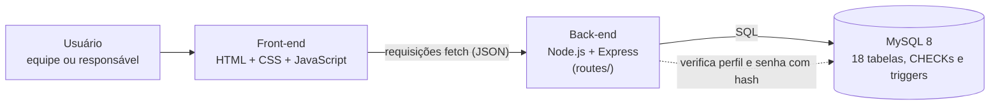
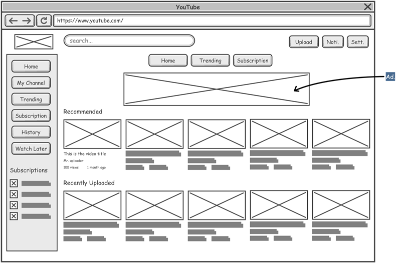
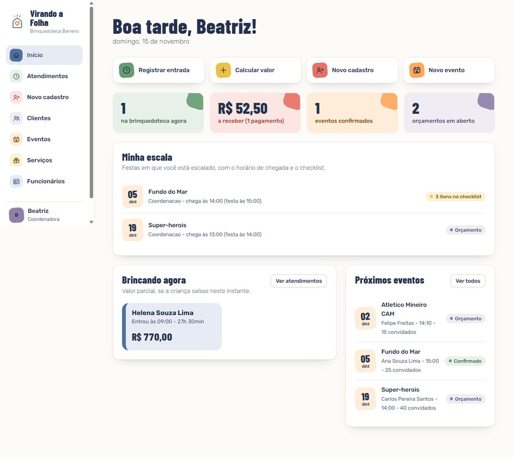
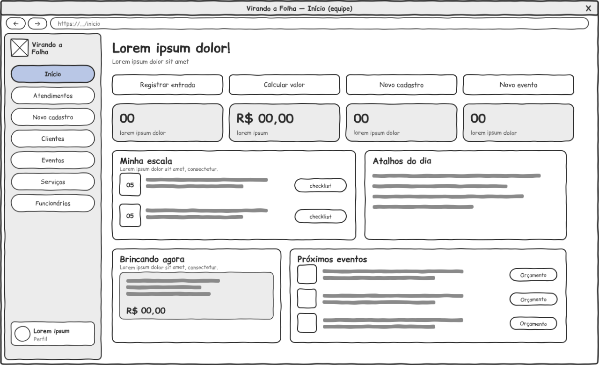
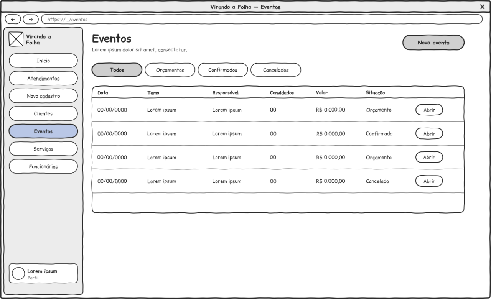
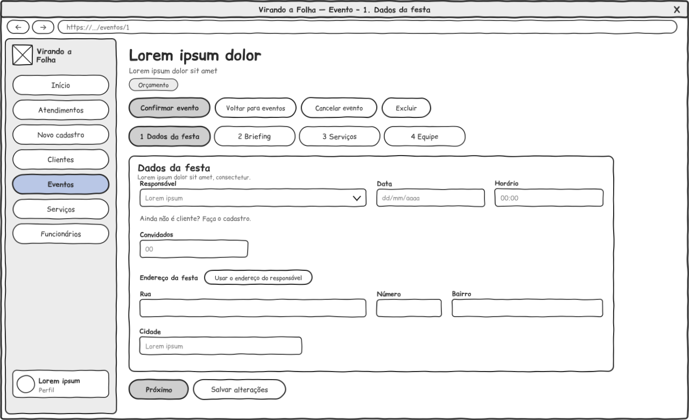
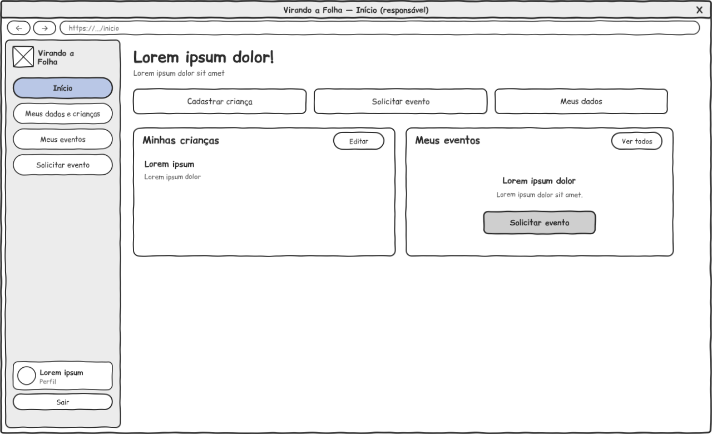
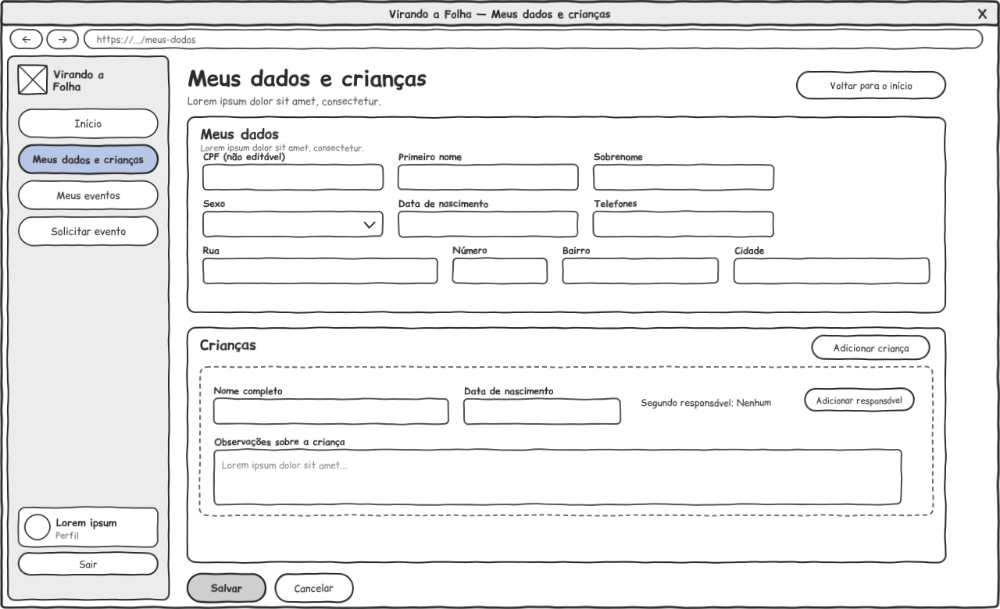
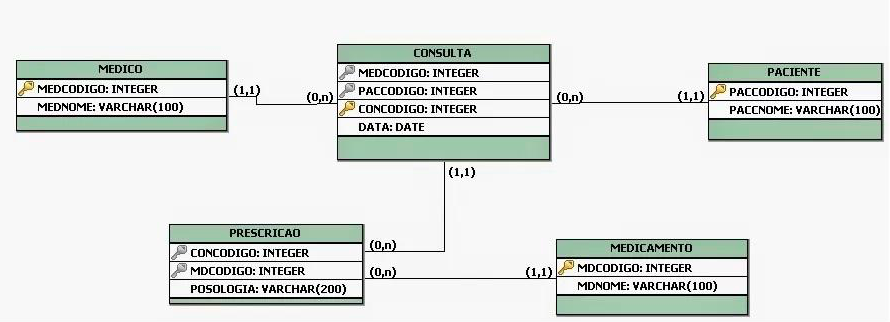

## 4. Projeto da Solução

<span style="color:red">Pré-requisitos: <a href="3-Modelagem-Processos-Negócio.md"> Modelagem do Processo de Negocio</a></span>

## 4.1. Arquitetura da solução

O Virando a Folha é uma aplicação web em três camadas: o navegador (front-end), um servidor de aplicação (back-end) e o banco de dados relacional.



**Como uma interação percorre o sistema:** o usuário abre uma tela do front-end (por exemplo, *Registrar entrada*), o JavaScript da página envia a requisição ao back-end com `fetch`, o back-end valida o perfil de acesso e executa o SQL no MySQL, e a resposta volta ao navegador, que atualiza a tela. As regras que não dependem da tela (CPF com 11 dígitos, hora de saída maior que a de entrada, um único responsável adicional por criança) ficam no próprio banco, por CHECKs e triggers.

**Módulos do sistema:**

| Módulo | O que faz | Perfis que usam |
| --- | --- | --- |
| Acesso | Login por CPF e senha (hash), criação de conta de responsável | Todos |
| Área do responsável | Meus dados e crianças, segundo responsável, meus eventos e solicitar evento | Responsável |
| Início (painel) | Atalhos, indicadores do dia, escala de festas e próximos eventos | Equipe |
| Atendimentos | Registrar entrada e saída, brincando agora, histórico, calculadora de valor e pagamento | Equipe |
| Cadastro e Clientes | Cadastro de famílias e lista de clientes | Equipe |
| Eventos | Orçamento em 4 passos, confirmação, equipe escalada e checklists | Equipe (a monitoria acompanha a escala e os checklists) |
| Serviços | Catálogo de serviços das festas | Coordenação (edita); recepção e monitoria (consultam, sem editar) |
| Funcionários | Cadastro de funcionários, funções, papéis, supervisor e acesso | Coordenação |

**Diagrama da arquitetura:**


O navegador carrega as páginas (HTML, CSS e JavaScript) e mostra os módulos conforme o perfil de acesso. As requisições e respostas trafegam em JSON pelo `fetch`. O servidor Node.js com Express recebe as requisições, aplica as regras de cada módulo e fala com o banco MySQL 8 por SQL.

> ⚠️ **CONFERIR:** o diagrama não mostra uma hospedagem (como o Heroku do exemplo do template), porque não foi informado onde o sistema roda na entrega. Se houver deploy, acrescente o servidor ou serviço usado.
>
> ⚠️ **CONFERIR:** a stack (Node.js, Express, MySQL 8, front em HTML/CSS/JS com `fetch`) e a pasta `routes/` vêm do que foi combinado no desenvolvimento. Confirme com o `package.json` e com a estrutura real do repositório (nomes das pastas, bibliotecas de hash de senha etc.).

### 4.2. Protótipos de telas

Visão geral da interação do usuário pelas telas do sistema e protótipo interativo das telas com as funcionalidades que fazem parte do sistema (wireframes).
Apresente as principais interfaces da plataforma. Discuta como ela foi elaborada de forma a atender os requisitos funcionais, não funcionais e histórias de usuário abordados nas <a href="2-Especificação.md"> Especificação do Projeto</a>.
A partir das atividades de usuário identificadas na seção anterior, elabore o protótipo de tela de cada uma delas.


São protótipos usados em design de interface para sugerir a estrutura de um site web e seu relacionamentos entre suas páginas. Um wireframe web é uma ilustração semelhante do layout de elementos fundamentais na interface.
 
> **Links Úteis**:
> - [Protótipos vs Wireframes](https://www.nngroup.com/videos/prototypes-vs-wireframes-ux-projects/)
> - [Ferramentas de Wireframes](https://rockcontent.com/blog/wireframes/)
> - [MarvelApp](https://marvelapp.com/developers/documentation/tutorials/)
> - [Figma](https://www.figma.com/)
> - [Adobe XD](https://www.adobe.com/br/products/xd.html#scroll)
> - [Axure](https://www.axure.com/edu) (Licença Educacional)
> - [InvisionApp](https://www.invisionapp.com/) (Licença Educacional)

As interfaces seguem a navegação por menu lateral, que muda conforme o perfil: a equipe vê Início, Atendimentos, Novo cadastro, Clientes, Eventos, Serviços e Funcionários (a recepção e a monitoria veem menos itens), e o responsável vê Início, Meus dados e crianças, Meus eventos e Solicitar evento. Os fluxos mais longos (cadastro de família e evento) são divididos em passos, o que ajuda a padronizar o atendimento. Todas as telas implementadas estão na seção [6. Interface do Sistema](6-Interface-Sistema.md).



#### Wireframes das telas

Os wireframes abaixo mostram a estrutura de cada tela principal do sistema (menu lateral à esquerda, conteúdo à direita). Eles foram desenhados a partir das telas finais do sistema (seção 6) e servem para mostrar o layout, sem as cores e a identidade visual. As imagens aparecem como caixas com X e os textos e valores são preenchidos com *lorem ipsum*, porque o que importa aqui é a estrutura.

**1. Login.** Entrada com CPF e senha, com atalho para criar conta de responsável.


**2. Criar conta de responsável.** Cadastro do responsável (dados, telefones e senha).


**3. Início da equipe.** Atalhos, indicadores do dia, escala de festas, crianças brincando agora e próximos eventos.



**4. Atendimentos: na brinquedoteca.** Registrar entrada (criança, recepcionista, monitores) e lista de crianças brincando agora, com saída e valor parcial.


**5. Atendimentos: calculadora de valor.** Calculadora por minuto, tabela rápida e tabela de preços por faixa, com desconto de irmãos.


**6. Novo cadastro.** Responsável e crianças na mesma tela, com segundo responsável e observações (alergias, cuidados).


**7. Clientes.** Lista de famílias com busca, edição e inclusão de criança.


**8. Eventos.** Lista de orçamentos e festas, com filtro por situação.



**9. Evento, passo 1: dados da festa.** Responsável, data, horário, convidados e endereço.



**10. Evento, passo 3: serviços.** Serviços contratados, quantidades, valores e total do orçamento.


**11. Evento, passo 4: equipe e checklists.** Equipe escalada (pessoa, função e horário) e checklists de antes e depois da festa.


**12. Funcionários (coordenação).** Lista de funcionários, papéis, supervisor e acesso, com a janela de novo funcionário.

")

**13. Serviços (coordenação).** Catálogo de serviços das festas; só a coordenação edita.

")

**14. Início do responsável.** Atalhos, crianças cadastradas e eventos do responsável.



**15. Meus dados e crianças.** Dados do responsável e cadastro das crianças, com segundo responsável.



**16. Solicitar evento (responsável).** Pedido de festa em 3 passos: dados da festa, briefing e serviços.

")

> ⚠️ **CONFERIR:** estes wireframes foram **redesenhados depois**, a partir das telas prontas. Se o grupo tiver protótipos feitos **antes** de programar (Figma, papel, Marvel etc.), coloque-os também aqui e ajuste o texto. Os arquivos editáveis (SVG) estão na pasta `wireframes-fonte/`.
>
> ⚠️ **FALTA:** wireframes da versão para **celular** (o sistema funciona no celular e no computador) e das telas de passo 2 (briefing) e passo 3 do evento do responsável, se o professor pedir.


## Diagrama de Classes

O diagrama de classes ilustra graficamente como será a estrutura do software, e como cada uma das classes da sua estrutura estarão interligadas. Essas classes servem de modelo para materializar os objetos que executarão na memória.

As referências abaixo irão auxiliá-lo na geração do artefato “Diagrama de Classes”.

> - [Diagramas de Classes - Documentação da IBM](https://www.ibm.com/docs/pt-br/rational-soft-arch/9.6.1?topic=diagrams-class)
> - [O que é um diagrama de classe UML? | Lucidchart](https://www.lucidchart.com/pages/pt/o-que-e-diagrama-de-classe-uml)

> ⚠️ **FALTA:** o grupo não enviou diagrama de classes. O sistema foi modelado direto em Modelo ER e esquema relacional (veja abaixo) e o back-end é em JavaScript. Confirme se o professor exige este diagrama; se exigir, ele ainda precisa ser feito (as classes seriam as 18 tabelas da seção 4.3.2).

## Modelo ER

O Modelo ER representa através de um diagrama como as entidades (coisas, objetos) se relacionam entre si na aplicação interativa.]

As referências abaixo irão auxiliá-lo na geração do artefato “Modelo ER”.

> - [Como fazer um diagrama entidade relacionamento | Lucidchart](https://www.lucidchart.com/pages/pt/como-fazer-um-diagrama-entidade-relacionamento)

O Modelo ER do sistema está em [4.3.1 Modelo ER](#431-modelo-er).


### 4.3. Modelo de dados

O desenvolvimento da solução proposta requer a existência de bases de dados que permitam efetuar os cadastros de dados e controles associados aos processos identificados, assim como recuperações.
Utilizando a notação do DER (Diagrama Entidade e Relacionamento), elaborem um modelo, na ferramenta visual indicada na disciplina, que contemple todas as entidades e atributos associados às atividades dos processos identificados. Deve ser gerado um único DER que suporte todos os processos escolhidos, visando, assim, uma base de dados integrada. O modelo deve contemplar, também, o controle de acesso de usuários (partes interessadas dos processos) de acordo com os papéis definidos nos modelos do processo de negócio.
_Apresente o modelo de dados por meio de um modelo relacional que contemple todos os conceitos e atributos apresentados na modelagem dos processos._

Um único DER dá suporte aos dois processos e ao controle de acesso. O banco tem **18 tabelas** e está na 3ª forma normal.

#### 4.3.1 Modelo ER

O Modelo ER representa através de um diagrama como as entidades (coisas, objetos) se relacionam entre si na aplicação interativa.]

As referências abaixo irão auxiliá-lo na geração do artefato “Modelo ER”.

> - [Como fazer um diagrama entidade relacionamento | Lucidchart](https://www.lucidchart.com/pages/pt/como-fazer-um-diagrama-entidade-relacionamento)

")

**Entidades e relacionamentos principais:**

- **PESSOA** guarda os dados comuns (CPF como chave, nome composto, sexo, data de nascimento, endereço composto, telefone multivalorado e idade derivada). Ela se especializa de forma **disjunta** em **RESPONSAVEL** e **FUNCIONARIO**: uma pessoa não é as duas coisas.
- **FUNCIONARIO** se especializa de forma **sobreposta** em **RECEPCIONISTA** e **MONITOR** (um funcionário pode ter os dois papéis) e se relaciona consigo mesmo em **SUPERVISIONA**.
- **CRIANCA** é entidade fraca de **RESPONSAVEL** (relacionamento identificador **POSSUI**); a chave parcial é `num_sequencial`. O relacionamento **ADICIONAL** liga a criança a um segundo responsável, opcional.
- **ATENDIMENTO** é **RECEBIDO** por uma criança, **REALIZADO** por um recepcionista e **ACOMPANHADO** por um ou mais monitores. O valor total é um atributo derivado (calculado pelo tempo); `pago` marca o pagamento.
- **EVENTO** é **SOLICITADO** por um responsável, **POSSUI** uma **FICHA_BRIEFING** (1:1), **TEM** itens em **CHECKLIST_EVENTO**, conta com funcionários pela entidade associativa **PARTICIPACAO** (função no evento e horário de atuação) e contrata serviços do catálogo **SERVICO** pela entidade associativa **CONTRATACAO** (quantidade e valor do serviço). O valor total do evento é derivado.
- **ACESSO** guarda o login (senha em hash e perfil) e se liga à pessoa pelo relacionamento **AUTENTICA** (no máximo um acesso por pessoa).
- **CONFIGURACAO** guarda parâmetros do sistema em pares chave e valor (por exemplo, o valor da hora).

As cardinalidades de cada relacionamento estão indicadas no próprio diagrama.

**Acréscimos do BPMN TO-BE ao modelo:** ACESSO, CHECKLIST_EVENTO, CONFIGURACAO, `ATENDIMENTO.pago` e `EVENTO.status` (orçamento, confirmado ou cancelado).

#### 4.3.2 Esquema Relacional

O Esquema Relacional corresponde à representação dos dados em tabelas juntamente com as restrições de integridade e chave primária.
 
As referências abaixo irão auxiliá-lo na geração do artefato “Esquema Relacional”.

> - [Criando um modelo relacional - Documentação da IBM](https://www.ibm.com/docs/pt-br/cognos-analytics/10.2.2?topic=designer-creating-relational-model)


---

*(a imagem acima é o exemplo do template)*

**Esquema relacional do sistema** (diagrama de esquema). Chaves primárias sublinhadas e chaves estrangeiras em rosa; as setas apontam da tabela com a chave estrangeira para a tabela referenciada.


**Esquema resultante** (chaves primárias em **negrito**; chaves estrangeiras indicadas por →):

- PESSOA(**cpf**, primeiro_nome, sobrenome, sexo, data_nascimento, rua, numero, bairro, cidade)
- TELEFONE_PESSOA(**cpf** → PESSOA, **telefone**)
- ACESSO(**cpf** → PESSOA, senha_hash, perfil)
- RESPONSAVEL(**cod_responsavel**, data_cadastro, cpf → PESSOA (único))
- FUNCIONARIO(**cod_funcionario**, data_cadastro, funcao, cpf → PESSOA (único), cod_supervisor → FUNCIONARIO)
- RECEPCIONISTA(**cod_recepcionista**, cod_funcionario → FUNCIONARIO (único))
- MONITOR(**cod_monitor**, cod_funcionario → FUNCIONARIO (único))
- CRIANCA(**cod_responsavel** → RESPONSAVEL, **num_sequencial**, nome, data_nascimento, observacoes)
- RESPONSAVEL_ADICIONAL(**(cod_responsavel, num_sequencial)** → CRIANCA, **cod_responsavel_adicional** → RESPONSAVEL)
- ATENDIMENTO(**cod_atendimento**, data, hora_entrada, hora_saida, pago, (cod_responsavel, num_sequencial) → CRIANCA, cod_recepcionista → RECEPCIONISTA)
- ACOMPANHA(**cod_atendimento** → ATENDIMENTO, **cod_monitor** → MONITOR)
- EVENTO(**cod_evento**, data, horario, qtd_convidados, rua, numero, bairro, cidade, status, cod_responsavel → RESPONSAVEL)
- FICHA_BRIEFING(**cod_briefing**, tema, observacoes, cod_evento → EVENTO (único))
- CHECKLIST_EVENTO(**cod_checklist**, cod_evento → EVENTO, tipo, item, concluido)
- SERVICO(**cod_servico**, nome (único), descricao, valor)
- PARTICIPACAO(**cod_funcionario** → FUNCIONARIO, **cod_evento** → EVENTO, funcao_evento, horario_atuacao)
- CONTRATACAO(**cod_evento** → EVENTO, **cod_servico** → SERVICO, quantidade, valor_servico)
- CONFIGURACAO(**chave**, valor)

**Regras de mapeamento do MER para o relacional:**

| Regra | Onde aparece | Como foi mapeado |
| --- | --- | --- |
| Entidade forte | PESSOA, ATENDIMENTO, EVENTO, SERVICO | Uma tabela por entidade; o endereço (atributo composto) virou as colunas rua, numero, bairro e cidade |
| Entidade fraca | CRIANCA (depende de RESPONSAVEL) | Chave primária composta: `cod_responsavel` + `num_sequencial` (numerado por trigger: 1, 2, 3...) |
| Relacionamento 1:N | SUPERVISIONA, SOLICITA, REALIZA, RECEBE | A chave do lado 1 vira chave estrangeira no lado N |
| Relacionamento N:N | ACOMPANHA, PARTICIPACAO, CONTRATACAO, ADICIONAL | Tabela própria com chave composta pelas chaves estrangeiras; atributos do relacionamento vão para ela |
| Relacionamento 1:1 | EVENTO e FICHA_BRIEFING | Chave estrangeira `cod_evento` em FICHA_BRIEFING, com UNIQUE |
| Atributo multivalorado | Telefone de PESSOA | Tabela TELEFONE_PESSOA, chave (cpf, telefone) |
| Generalização/especialização | PESSOA → RESPONSAVEL e FUNCIONARIO (disjunta); FUNCIONARIO → RECEPCIONISTA e MONITOR (sobreposta) | Uma tabela para a superclasse e uma por subclasse, com chave estrangeira UNIQUE; a disjunção é garantida por triggers |

**Normalização (até a 3FN):**

- **1FN:** todos os atributos são atômicos. O endereço foi dividido em colunas, os telefones ficam em TELEFONE_PESSOA e o responsável adicional fica em RESPONSAVEL_ADICIONAL.
- **2FN:** nenhum atributo depende de parte de uma chave composta (em CRIANCA, PARTICIPACAO e CONTRATACAO, os atributos dependem do par completo).
- **3FN:** nenhum atributo não chave depende de outro não chave. Nome e endereço ficam só em PESSOA; ATENDIMENTO não guarda o valor cobrado, que é calculado pelo tempo de permanência.

O **dicionário de dados** completo das 18 tabelas está em [4-Dicionario-de-Dados.md](4-Dicionario-de-Dados.md).

> ⚠️ **CONFERIR:** as imagens `Relacional_01.jpg`, `modeloRelacional.*`, `er_diagram.png` e `process.png` da pasta `imagem/` são **exemplos do template**. Apague as que não usar.


#### 4.3.3 Modelo Físico

Insira aqui o script de criação das tabelas do banco de dados.

Veja um exemplo:

<!-- EXEMPLO DO TEMPLATE (mantido para consulta):
<code>

 -- Criação da tabela Médico
CREATE TABLE Medico (
    MedCodigo INTEGER PRIMARY KEY,
    MedNome VARCHAR(100)
);


-- Criação da tabela Paciente
CREATE TABLE Paciente (
    PacCodigo INTEGER PRIMARY KEY,
    PacNome VARCHAR(100)
);

-- Criação da tabela Consulta
CREATE TABLE Consulta (
    ConCodigo INTEGER PRIMARY KEY,
    MedCodigo INTEGER,
    PacCodigo INTEGER,
    Data DATE,
    FOREIGN KEY (MedCodigo) REFERENCES Medico(MedCodigo),
    FOREIGN KEY (PacCodigo) REFERENCES Paciente(PacCodigo)
);

-- Criação da tabela Medicamento
CREATE TABLE Medicamento (
    MdcCodigo INTEGER PRIMARY KEY,
    MdcNome VARCHAR(100)
);

-- Criação da tabela Prescricao
CREATE TABLE Prescricao (
    ConCodigo INTEGER,
    MdcCodigo INTEGER,
    Posologia VARCHAR(200),
    PRIMARY KEY (ConCodigo, MdcCodigo),
    FOREIGN KEY (ConCodigo) REFERENCES Consulta(ConCodigo),
    FOREIGN KEY (MdcCodigo) REFERENCES Medicamento(MdcCodigo)
);

</code>
-->

Este script deverá ser incluído em um arquivo .sql na pasta src\bd.

> ⚠️ **CONFERIR:** o script abaixo foi **reconstruído a partir do Dicionário de Dados / Projeto Lógico (Fase 2)**, porque o `schema.sql` oficial do grupo não foi enviado. Ele foi testado num MariaDB 10.11 (criou as 18 tabelas e 12 triggers, e recusou os dados inválidos testados), mas **não** no MySQL 8 do grupo. Compare com o `schema.sql` real do repositório: se houver diferença, vale o do repositório. Salve o script final em `src/bd/schema.sql`.

##### Diagrama do modelo físico (EER)

Diagrama gerado por engenharia reversa do banco criado pelo script abaixo (linha cheia = relacionamento identificador, a FK faz parte da PK; linha tracejada = FK comum; "pé de galinha" no lado "muitos").

 do banco brinquedoteca")

> ⚠️ **FALTA PRINT (opcional):** o professor pode pedir o print do **MySQL Workbench** (*Database > Reverse Engineer*). Passos: abra o Workbench, conecte no banco `brinquedoteca`, use *Database > Reverse Engineer...*, marque o schema e finalize; o diagrama EER abre sozinho. Exporte em *File > Export > Export as PNG*.

##### Script de criação (DDL + triggers)

<details>
<summary>Clique para ver o script completo (<code>src/bd/schema.sql</code>)</summary>

```sql
-- =====================================================================
-- Virando a Folha | Brinquedoteca Barreiro
-- Modelo físico (MySQL 8): 18 tabelas, CHECKs e triggers
--
-- ATENÇÃO: script escrito a partir do dicionário de dados da Fase 2
-- (projeto lógico corrigido). Se existir o schema.sql oficial do grupo,
-- confira as diferenças antes de entregar.
-- =====================================================================

CREATE DATABASE IF NOT EXISTS brinquedoteca
    CHARACTER SET utf8mb4 COLLATE utf8mb4_unicode_ci;
USE brinquedoteca;

-- ---------------------------------------------------------------------
-- 1. PESSOA (superclasse de RESPONSAVEL e FUNCIONARIO)
-- ---------------------------------------------------------------------
CREATE TABLE PESSOA (
    cpf             CHAR(11)     NOT NULL,
    primeiro_nome   VARCHAR(50)  NOT NULL,
    sobrenome       VARCHAR(100) NOT NULL,
    sexo            CHAR(1)      NOT NULL,
    data_nascimento DATE         NOT NULL,
    rua             VARCHAR(100) NOT NULL,
    numero          VARCHAR(10)  NOT NULL,
    bairro          VARCHAR(60)  NOT NULL,
    cidade          VARCHAR(60)  NOT NULL,
    CONSTRAINT pk_pessoa PRIMARY KEY (cpf),
    CONSTRAINT ck_pessoa_cpf  CHECK (cpf REGEXP '^[0-9]{11}$'),
    CONSTRAINT ck_pessoa_sexo CHECK (sexo IN ('M', 'F', 'O'))
) ENGINE = InnoDB;

-- ---------------------------------------------------------------------
-- 2. TELEFONE_PESSOA (atributo multivalorado de PESSOA)
-- ---------------------------------------------------------------------
CREATE TABLE TELEFONE_PESSOA (
    cpf      CHAR(11)    NOT NULL,
    telefone VARCHAR(15) NOT NULL,
    CONSTRAINT pk_telefone_pessoa PRIMARY KEY (cpf, telefone),
    CONSTRAINT fk_telefone_pessoa FOREIGN KEY (cpf)
        REFERENCES PESSOA (cpf) ON DELETE CASCADE ON UPDATE CASCADE,
    CONSTRAINT ck_telefone CHECK (telefone REGEXP '^[0-9]{1,15}$')
) ENGINE = InnoDB;

-- ---------------------------------------------------------------------
-- 3. ACESSO (login do sistema)
-- ---------------------------------------------------------------------
CREATE TABLE ACESSO (
    cpf        CHAR(11)     NOT NULL,
    senha_hash VARCHAR(200) NOT NULL,
    perfil     VARCHAR(12)  NOT NULL,
    CONSTRAINT pk_acesso PRIMARY KEY (cpf),
    CONSTRAINT fk_acesso_pessoa FOREIGN KEY (cpf)
        REFERENCES PESSOA (cpf) ON DELETE CASCADE ON UPDATE NO ACTION,
    CONSTRAINT ck_acesso_perfil CHECK (perfil IN ('ADMIN', 'FUNCIONARIO', 'RESPONSAVEL'))
) ENGINE = InnoDB;

-- ---------------------------------------------------------------------
-- 4. RESPONSAVEL (especialização de PESSOA)
-- ---------------------------------------------------------------------
CREATE TABLE RESPONSAVEL (
    cod_responsavel INT      NOT NULL AUTO_INCREMENT,
    data_cadastro   DATE     NOT NULL DEFAULT (CURRENT_DATE),
    cpf             CHAR(11) NOT NULL,
    CONSTRAINT pk_responsavel PRIMARY KEY (cod_responsavel),
    CONSTRAINT uq_responsavel_cpf UNIQUE (cpf),
    CONSTRAINT fk_responsavel_pessoa FOREIGN KEY (cpf)
        REFERENCES PESSOA (cpf) ON DELETE RESTRICT ON UPDATE CASCADE
) ENGINE = InnoDB;

-- ---------------------------------------------------------------------
-- 5. FUNCIONARIO (especialização de PESSOA, com supervisão)
-- ---------------------------------------------------------------------
CREATE TABLE FUNCIONARIO (
    cod_funcionario INT         NOT NULL AUTO_INCREMENT,
    data_cadastro   DATE        NOT NULL DEFAULT (CURRENT_DATE),
    funcao          VARCHAR(50) NOT NULL,
    cpf             CHAR(11)    NOT NULL,
    cod_supervisor  INT         NULL DEFAULT NULL,
    CONSTRAINT pk_funcionario PRIMARY KEY (cod_funcionario),
    CONSTRAINT uq_funcionario_cpf UNIQUE (cpf),
    CONSTRAINT fk_funcionario_pessoa FOREIGN KEY (cpf)
        REFERENCES PESSOA (cpf) ON DELETE RESTRICT ON UPDATE CASCADE,
    CONSTRAINT fk_funcionario_supervisor FOREIGN KEY (cod_supervisor)
        REFERENCES FUNCIONARIO (cod_funcionario) ON DELETE SET NULL ON UPDATE CASCADE
) ENGINE = InnoDB;

-- ---------------------------------------------------------------------
-- 6. RECEPCIONISTA (especialização sobreposta de FUNCIONARIO)
-- ---------------------------------------------------------------------
CREATE TABLE RECEPCIONISTA (
    cod_recepcionista INT NOT NULL AUTO_INCREMENT,
    cod_funcionario   INT NOT NULL,
    CONSTRAINT pk_recepcionista PRIMARY KEY (cod_recepcionista),
    CONSTRAINT uq_recepcionista_func UNIQUE (cod_funcionario),
    CONSTRAINT fk_recepcionista_func FOREIGN KEY (cod_funcionario)
        REFERENCES FUNCIONARIO (cod_funcionario) ON DELETE CASCADE ON UPDATE CASCADE
) ENGINE = InnoDB;

-- ---------------------------------------------------------------------
-- 7. MONITOR (especialização sobreposta de FUNCIONARIO)
-- ---------------------------------------------------------------------
CREATE TABLE MONITOR (
    cod_monitor     INT NOT NULL AUTO_INCREMENT,
    cod_funcionario INT NOT NULL,
    CONSTRAINT pk_monitor PRIMARY KEY (cod_monitor),
    CONSTRAINT uq_monitor_func UNIQUE (cod_funcionario),
    CONSTRAINT fk_monitor_func FOREIGN KEY (cod_funcionario)
        REFERENCES FUNCIONARIO (cod_funcionario) ON DELETE CASCADE ON UPDATE CASCADE
) ENGINE = InnoDB;

-- ---------------------------------------------------------------------
-- 8. CRIANCA (entidade fraca de RESPONSAVEL)
-- ---------------------------------------------------------------------
CREATE TABLE CRIANCA (
    cod_responsavel INT          NOT NULL,
    num_sequencial  INT          NOT NULL DEFAULT 0,
    nome            VARCHAR(100) NOT NULL,
    data_nascimento DATE         NOT NULL,
    observacoes     VARCHAR(255) NULL DEFAULT NULL,
    CONSTRAINT pk_crianca PRIMARY KEY (cod_responsavel, num_sequencial),
    CONSTRAINT fk_crianca_responsavel FOREIGN KEY (cod_responsavel)
        REFERENCES RESPONSAVEL (cod_responsavel) ON DELETE CASCADE ON UPDATE CASCADE
) ENGINE = InnoDB;

-- ---------------------------------------------------------------------
-- 9. RESPONSAVEL_ADICIONAL (segundo responsável, opcional)
-- ---------------------------------------------------------------------
CREATE TABLE RESPONSAVEL_ADICIONAL (
    cod_responsavel           INT NOT NULL,
    num_sequencial            INT NOT NULL,
    cod_responsavel_adicional INT NOT NULL,
    CONSTRAINT pk_resp_adicional
        PRIMARY KEY (cod_responsavel, num_sequencial, cod_responsavel_adicional),
    CONSTRAINT fk_resp_adicional_crianca FOREIGN KEY (cod_responsavel, num_sequencial)
        REFERENCES CRIANCA (cod_responsavel, num_sequencial) ON DELETE CASCADE ON UPDATE CASCADE,
    CONSTRAINT fk_resp_adicional_resp FOREIGN KEY (cod_responsavel_adicional)
        REFERENCES RESPONSAVEL (cod_responsavel) ON DELETE RESTRICT ON UPDATE CASCADE
) ENGINE = InnoDB;

-- ---------------------------------------------------------------------
-- 10. ATENDIMENTO (entrada e saída da criança)
-- ---------------------------------------------------------------------
CREATE TABLE ATENDIMENTO (
    cod_atendimento   INT     NOT NULL AUTO_INCREMENT,
    data              DATE    NOT NULL DEFAULT (CURRENT_DATE),
    hora_entrada      TIME    NOT NULL,
    hora_saida        TIME    NULL DEFAULT NULL,
    pago              BOOLEAN NOT NULL DEFAULT FALSE,
    cod_responsavel   INT     NOT NULL,
    num_sequencial    INT     NOT NULL,
    cod_recepcionista INT     NOT NULL,
    CONSTRAINT pk_atendimento PRIMARY KEY (cod_atendimento),
    CONSTRAINT fk_atendimento_crianca FOREIGN KEY (cod_responsavel, num_sequencial)
        REFERENCES CRIANCA (cod_responsavel, num_sequencial) ON DELETE RESTRICT ON UPDATE CASCADE,
    CONSTRAINT fk_atendimento_recep FOREIGN KEY (cod_recepcionista)
        REFERENCES RECEPCIONISTA (cod_recepcionista) ON DELETE RESTRICT ON UPDATE CASCADE,
    CONSTRAINT ck_atendimento_horas CHECK (hora_saida IS NULL OR hora_saida > hora_entrada)
) ENGINE = InnoDB;

-- ---------------------------------------------------------------------
-- 11. ACOMPANHA (monitores de cada atendimento, N:N)
-- ---------------------------------------------------------------------
CREATE TABLE ACOMPANHA (
    cod_atendimento INT NOT NULL,
    cod_monitor     INT NOT NULL,
    CONSTRAINT pk_acompanha PRIMARY KEY (cod_atendimento, cod_monitor),
    CONSTRAINT fk_acompanha_atend FOREIGN KEY (cod_atendimento)
        REFERENCES ATENDIMENTO (cod_atendimento) ON DELETE CASCADE ON UPDATE CASCADE,
    CONSTRAINT fk_acompanha_monitor FOREIGN KEY (cod_monitor)
        REFERENCES MONITOR (cod_monitor) ON DELETE RESTRICT ON UPDATE CASCADE
) ENGINE = InnoDB;

-- ---------------------------------------------------------------------
-- 12. EVENTO (festas e atividades temáticas)
-- ---------------------------------------------------------------------
CREATE TABLE EVENTO (
    cod_evento      INT          NOT NULL AUTO_INCREMENT,
    data            DATE         NOT NULL,
    horario         TIME         NOT NULL,
    qtd_convidados  INT          NOT NULL,
    rua             VARCHAR(100) NOT NULL,
    numero          VARCHAR(10)  NOT NULL,
    bairro          VARCHAR(60)  NOT NULL,
    cidade          VARCHAR(60)  NOT NULL,
    status          ENUM('ORCAMENTO', 'CONFIRMADO', 'CANCELADO') NOT NULL DEFAULT 'ORCAMENTO',
    cod_responsavel INT          NOT NULL,
    CONSTRAINT pk_evento PRIMARY KEY (cod_evento),
    CONSTRAINT fk_evento_responsavel FOREIGN KEY (cod_responsavel)
        REFERENCES RESPONSAVEL (cod_responsavel) ON DELETE RESTRICT ON UPDATE CASCADE,
    CONSTRAINT ck_evento_convidados CHECK (qtd_convidados > 0)
) ENGINE = InnoDB;

-- ---------------------------------------------------------------------
-- 13. FICHA_BRIEFING (1:1 com EVENTO)
-- ---------------------------------------------------------------------
CREATE TABLE FICHA_BRIEFING (
    cod_briefing INT          NOT NULL AUTO_INCREMENT,
    tema         VARCHAR(100) NOT NULL,
    observacoes  VARCHAR(255) NULL DEFAULT NULL,
    cod_evento   INT          NOT NULL,
    CONSTRAINT pk_ficha_briefing PRIMARY KEY (cod_briefing),
    CONSTRAINT uq_ficha_evento UNIQUE (cod_evento),
    CONSTRAINT fk_ficha_evento FOREIGN KEY (cod_evento)
        REFERENCES EVENTO (cod_evento) ON DELETE CASCADE ON UPDATE CASCADE
) ENGINE = InnoDB;

-- ---------------------------------------------------------------------
-- 14. CHECKLIST_EVENTO (checklists pré e pós-evento)
-- ---------------------------------------------------------------------
CREATE TABLE CHECKLIST_EVENTO (
    cod_checklist INT          NOT NULL AUTO_INCREMENT,
    cod_evento    INT          NOT NULL,
    tipo          ENUM('PRE', 'POS') NOT NULL,
    item          VARCHAR(150) NOT NULL,
    concluido     BOOLEAN      NOT NULL DEFAULT FALSE,
    CONSTRAINT pk_checklist PRIMARY KEY (cod_checklist),
    CONSTRAINT fk_checklist_evento FOREIGN KEY (cod_evento)
        REFERENCES EVENTO (cod_evento) ON DELETE CASCADE ON UPDATE CASCADE
) ENGINE = InnoDB;

-- ---------------------------------------------------------------------
-- 15. SERVICO (catálogo de serviços das festas)
-- ---------------------------------------------------------------------
CREATE TABLE SERVICO (
    cod_servico INT           NOT NULL AUTO_INCREMENT,
    nome        VARCHAR(100)  NOT NULL,
    descricao   VARCHAR(255)  NULL DEFAULT NULL,
    valor       DECIMAL(10,2) NOT NULL DEFAULT 0.00,
    CONSTRAINT pk_servico PRIMARY KEY (cod_servico),
    CONSTRAINT uq_servico_nome UNIQUE (nome),
    CONSTRAINT ck_servico_valor CHECK (valor >= 0)
) ENGINE = InnoDB;

-- ---------------------------------------------------------------------
-- 16. PARTICIPACAO (equipe escalada no evento, N:N)
-- ---------------------------------------------------------------------
CREATE TABLE PARTICIPACAO (
    cod_funcionario INT         NOT NULL,
    cod_evento      INT         NOT NULL,
    funcao_evento   VARCHAR(50) NOT NULL,
    horario_atuacao TIME        NOT NULL,
    CONSTRAINT pk_participacao PRIMARY KEY (cod_funcionario, cod_evento),
    CONSTRAINT fk_participacao_func FOREIGN KEY (cod_funcionario)
        REFERENCES FUNCIONARIO (cod_funcionario) ON DELETE RESTRICT ON UPDATE CASCADE,
    CONSTRAINT fk_participacao_evento FOREIGN KEY (cod_evento)
        REFERENCES EVENTO (cod_evento) ON DELETE CASCADE ON UPDATE CASCADE
) ENGINE = InnoDB;

-- ---------------------------------------------------------------------
-- 17. CONTRATACAO (serviços contratados no evento, N:N)
-- ---------------------------------------------------------------------
CREATE TABLE CONTRATACAO (
    cod_evento    INT           NOT NULL,
    cod_servico   INT           NOT NULL,
    quantidade    INT           NOT NULL DEFAULT 1,
    valor_servico DECIMAL(10,2) NOT NULL,
    CONSTRAINT pk_contratacao PRIMARY KEY (cod_evento, cod_servico),
    CONSTRAINT fk_contratacao_evento FOREIGN KEY (cod_evento)
        REFERENCES EVENTO (cod_evento) ON DELETE CASCADE ON UPDATE CASCADE,
    CONSTRAINT fk_contratacao_servico FOREIGN KEY (cod_servico)
        REFERENCES SERVICO (cod_servico) ON DELETE RESTRICT ON UPDATE CASCADE,
    CONSTRAINT ck_contratacao_qtd   CHECK (quantidade > 0),
    CONSTRAINT ck_contratacao_valor CHECK (valor_servico >= 0)
) ENGINE = InnoDB;

-- ---------------------------------------------------------------------
-- 18. CONFIGURACAO (parâmetros do sistema, como valor_hora)
-- ---------------------------------------------------------------------
CREATE TABLE CONFIGURACAO (
    chave VARCHAR(50)   NOT NULL,
    valor DECIMAL(10,2) NOT NULL,
    CONSTRAINT pk_configuracao PRIMARY KEY (chave)
) ENGINE = InnoDB;

-- =====================================================================
-- TRIGGERS (regras que o CHECK do MySQL não consegue validar)
-- =====================================================================
DELIMITER $$

-- Data de nascimento não pode ser futura (PESSOA)
CREATE TRIGGER trg_pessoa_bi BEFORE INSERT ON PESSOA FOR EACH ROW
BEGIN
    IF NEW.data_nascimento > CURRENT_DATE THEN
        SIGNAL SQLSTATE '45000' SET MESSAGE_TEXT = 'Data de nascimento não pode ser futura.';
    END IF;
END$$

CREATE TRIGGER trg_pessoa_bu BEFORE UPDATE ON PESSOA FOR EACH ROW
BEGIN
    IF NEW.data_nascimento > CURRENT_DATE THEN
        SIGNAL SQLSTATE '45000' SET MESSAGE_TEXT = 'Data de nascimento não pode ser futura.';
    END IF;
END$$

-- Disjunção: uma pessoa não pode ser responsável e funcionário ao mesmo tempo
CREATE TRIGGER trg_responsavel_bi BEFORE INSERT ON RESPONSAVEL FOR EACH ROW
BEGIN
    IF EXISTS (SELECT 1 FROM FUNCIONARIO WHERE cpf = NEW.cpf) THEN
        SIGNAL SQLSTATE '45000' SET MESSAGE_TEXT = 'Esta pessoa já é funcionário e não pode ser responsável.';
    END IF;
END$$

CREATE TRIGGER trg_responsavel_bu BEFORE UPDATE ON RESPONSAVEL FOR EACH ROW
BEGIN
    IF NEW.cpf <> OLD.cpf AND EXISTS (SELECT 1 FROM FUNCIONARIO WHERE cpf = NEW.cpf) THEN
        SIGNAL SQLSTATE '45000' SET MESSAGE_TEXT = 'Esta pessoa já é funcionário e não pode ser responsável.';
    END IF;
END$$

CREATE TRIGGER trg_funcionario_bi BEFORE INSERT ON FUNCIONARIO FOR EACH ROW
BEGIN
    IF EXISTS (SELECT 1 FROM RESPONSAVEL WHERE cpf = NEW.cpf) THEN
        SIGNAL SQLSTATE '45000' SET MESSAGE_TEXT = 'Esta pessoa já é responsável e não pode ser funcionário.';
    END IF;
END$$

CREATE TRIGGER trg_funcionario_bu BEFORE UPDATE ON FUNCIONARIO FOR EACH ROW
BEGIN
    IF NEW.cpf <> OLD.cpf AND EXISTS (SELECT 1 FROM RESPONSAVEL WHERE cpf = NEW.cpf) THEN
        SIGNAL SQLSTATE '45000' SET MESSAGE_TEXT = 'Esta pessoa já é responsável e não pode ser funcionário.';
    END IF;
    IF NEW.cod_supervisor IS NOT NULL AND NEW.cod_supervisor = NEW.cod_funcionario THEN
        SIGNAL SQLSTATE '45000' SET MESSAGE_TEXT = 'Um funcionário não pode supervisionar a si mesmo.';
    END IF;
END$$

-- CRIANCA: numeração sequencial por responsável (1, 2, 3...) e data válida
CREATE TRIGGER trg_crianca_bi BEFORE INSERT ON CRIANCA FOR EACH ROW
BEGIN
    IF NEW.data_nascimento > CURRENT_DATE THEN
        SIGNAL SQLSTATE '45000' SET MESSAGE_TEXT = 'Data de nascimento não pode ser futura.';
    END IF;
    IF NEW.num_sequencial IS NULL OR NEW.num_sequencial = 0 THEN
        SET NEW.num_sequencial = (SELECT IFNULL(MAX(c.num_sequencial), 0) + 1
                                  FROM CRIANCA c
                                  WHERE c.cod_responsavel = NEW.cod_responsavel);
    END IF;
END$$

CREATE TRIGGER trg_crianca_bu BEFORE UPDATE ON CRIANCA FOR EACH ROW
BEGIN
    IF NEW.data_nascimento > CURRENT_DATE THEN
        SIGNAL SQLSTATE '45000' SET MESSAGE_TEXT = 'Data de nascimento não pode ser futura.';
    END IF;
END$$

-- RESPONSAVEL_ADICIONAL: diferente do principal e no máximo um por criança
CREATE TRIGGER trg_resp_adicional_bi BEFORE INSERT ON RESPONSAVEL_ADICIONAL FOR EACH ROW
BEGIN
    IF NEW.cod_responsavel_adicional = NEW.cod_responsavel THEN
        SIGNAL SQLSTATE '45000' SET MESSAGE_TEXT = 'O responsável adicional deve ser diferente do principal.';
    END IF;
    IF EXISTS (SELECT 1 FROM RESPONSAVEL_ADICIONAL ra
               WHERE ra.cod_responsavel = NEW.cod_responsavel
                 AND ra.num_sequencial  = NEW.num_sequencial) THEN
        SIGNAL SQLSTATE '45000' SET MESSAGE_TEXT = 'A criança já tem um responsável adicional.';
    END IF;
END$$

CREATE TRIGGER trg_resp_adicional_bu BEFORE UPDATE ON RESPONSAVEL_ADICIONAL FOR EACH ROW
BEGIN
    IF NEW.cod_responsavel_adicional = NEW.cod_responsavel THEN
        SIGNAL SQLSTATE '45000' SET MESSAGE_TEXT = 'O responsável adicional deve ser diferente do principal.';
    END IF;
END$$

-- ATENDIMENTO: a data não pode ser futura
CREATE TRIGGER trg_atendimento_bi BEFORE INSERT ON ATENDIMENTO FOR EACH ROW
BEGIN
    IF NEW.data > CURRENT_DATE THEN
        SIGNAL SQLSTATE '45000' SET MESSAGE_TEXT = 'A data do atendimento não pode ser futura.';
    END IF;
END$$

CREATE TRIGGER trg_atendimento_bu BEFORE UPDATE ON ATENDIMENTO FOR EACH ROW
BEGIN
    IF NEW.data > CURRENT_DATE THEN
        SIGNAL SQLSTATE '45000' SET MESSAGE_TEXT = 'A data do atendimento não pode ser futura.';
    END IF;
END$$

DELIMITER ;
```

</details>

**Triggers criados (12):** data de nascimento não futura (PESSOA e CRIANCA); disjunção RESPONSAVEL/FUNCIONARIO; `cod_supervisor` diferente do próprio funcionário; numeração automática `num_sequencial` da CRIANCA; responsável adicional diferente do principal e no máximo um por criança; data do atendimento não futura.


### 4.4. Tecnologias

_Descreva qual(is) tecnologias você vai usar para resolver o seu problema, ou seja, implementar a sua solução. Liste todas as tecnologias envolvidas, linguagens a serem utilizadas, serviços web, frameworks, bibliotecas, IDEs de desenvolvimento, e ferramentas._

Apresente também uma figura explicando como as tecnologias estão relacionadas ou como uma interação do usuário com o sistema vai ser conduzida, por onde ela passa até retornar uma resposta ao usuário.

<!-- EXEMPLO DO TEMPLATE (mantido para consulta):
| **Dimensão**   | **Tecnologia**  |
| ---            | ---             |
| SGBD           | MySQL           |
| Front end      | HTML+CSS+JS     |
| Back end       | Java SpringBoot |
| Deploy         | Github Pages    |
-->

| **Dimensão**   | **Tecnologia**  |
| ---            | ---             |
| SGBD           | MySQL 8 (consultas e modelagem no MySQL Workbench) |
| Front end      | HTML + CSS + JavaScript (requisições com `fetch`) |
| Back end       | Node.js + Express |
| Controle de versão | Git e GitHub |
| Modelagem de processos | BPMN (ferramenta da disciplina) |
| Deploy         | ⚠️ preencher |

A figura que mostra como as tecnologias se relacionam é o diagrama da seção [4.1](#41-arquitetura-da-solução).

> ⚠️ **CONFERIR:** versões do Node.js, nome das bibliotecas do `package.json` (por exemplo, a de conexão com o MySQL e a de hash de senha), ferramenta usada no BPMN e no MER. Confirme também o **deploy**: o banco foi rodado localmente no computador do grupo; se houve hospedagem online, informe onde.
