## 4. Projeto da Solução

<span style="color:red">Pré-requisitos: <a href="3-Modelagem-Processos-Negócio.md"> Modelagem do Processo de Negocio</a></span>

## 4.1. Arquitetura da solução

O Virando a Folha é uma aplicação web em três camadas: o navegador (front-end), um servidor de aplicação (back-end) e o banco de dados relacional.

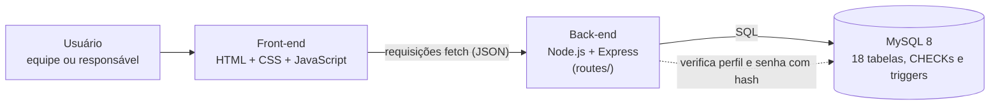

**Como uma interação percorre o sistema:** o usuário abre uma tela do front-end (por exemplo, *Registrar entrada*), o JavaScript da página envia a requisição ao back-end com `fetch`, o back-end valida o perfil de acesso e executa o SQL no MySQL, e a resposta volta ao navegador, que atualiza a tela. As regras que não dependem da tela (CPF com 11 dígitos, hora de saída maior que a de entrada, um único responsável adicional por criança) ficam no próprio banco, por CHECKs e triggers.

**Módulos do sistema:**

| Módulo | O que faz | Perfis que usam |
| --- | --- | --- |
| Acesso | Login por CPF e senha (hash), criação de conta de responsável | Todos |
| Área do responsável | Meus dados e crianças, segundo responsável, meus eventos e solicitar evento | Responsável |
| Início (painel) | Atalhos, indicadores do dia, escala de festas e próximos eventos | Equipe |
| Atendimentos | Registrar entrada e saída, brincando agora, histórico, calculadora de valor e pagamento | Equipe |
| Cadastro e Clientes | Cadastro de famílias e lista de clientes | Equipe |
| Eventos | Orçamento em 4 passos, confirmação, equipe escalada e checklists | Equipe (a monitoria acompanha a escala e os checklists) |
| Serviços | Catálogo de serviços das festas | Coordenação (edita); recepção e monitoria (consultam, sem editar) |
| Funcionários | Cadastro de funcionários, funções, papéis, supervisor e acesso | Coordenação |

**Diagrama da arquitetura:**

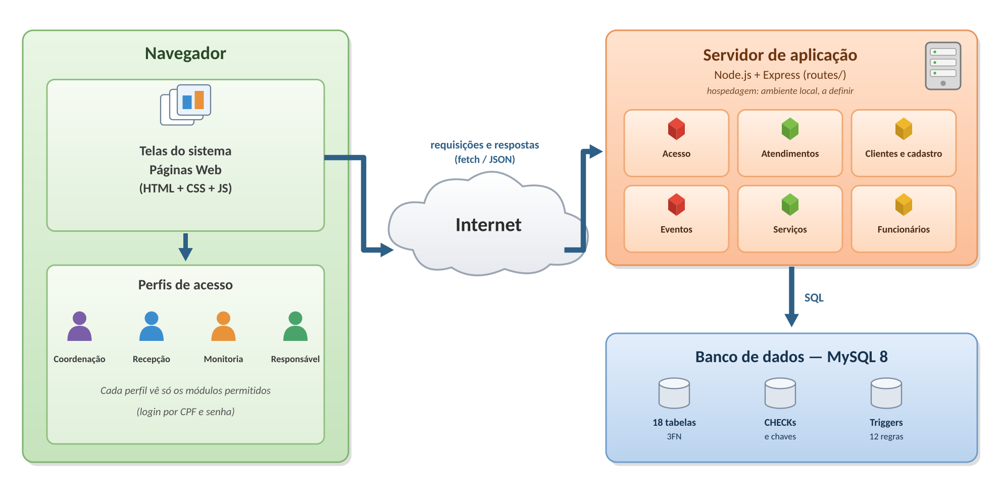

O navegador carrega as páginas (HTML, CSS e JavaScript) e mostra os módulos conforme o perfil de acesso. As requisições e respostas trafegam em JSON pelo `fetch`. O servidor Node.js com Express recebe as requisições, aplica as regras de cada módulo e fala com o banco MySQL 8 por SQL. O sistema roda localmente.

### 4.2. Protótipos de telas

Visão geral da interação do usuário pelas telas do sistema e protótipo interativo das telas com as funcionalidades que fazem parte do sistema (wireframes).
Apresente as principais interfaces da plataforma. Discuta como ela foi elaborada de forma a atender os requisitos funcionais, não funcionais e histórias de usuário abordados nas <a href="2-Especificação.md"> Especificação do Projeto</a>.

As interfaces seguem a navegação por menu lateral, que muda conforme o perfil: a equipe vê Início, Atendimentos, Novo cadastro, Clientes, Eventos, Serviços e Funcionários (a recepção e a monitoria veem menos itens), e o responsável vê Início, Meus dados e crianças, Meus eventos e Solicitar evento. Os fluxos mais longos (cadastro de família e evento) são divididos em passos, o que ajuda a padronizar o atendimento. Todas as telas implementadas estão na seção [6. Interface do Sistema](6-Interface-Sistema.md).


#### Wireframes das telas

Os wireframes abaixo mostram a estrutura de cada tela principal do sistema (menu lateral à esquerda, conteúdo à direita). Eles foram desenhados a partir das telas finais do sistema (seção 6) e servem para mostrar o layout, sem as cores e a identidade visual. As imagens aparecem como caixas com X e os textos e valores são preenchidos com *lorem ipsum*, porque o que importa aqui é a estrutura.

**1. Login.** Entrada com CPF e senha, com atalho para criar conta de responsável.

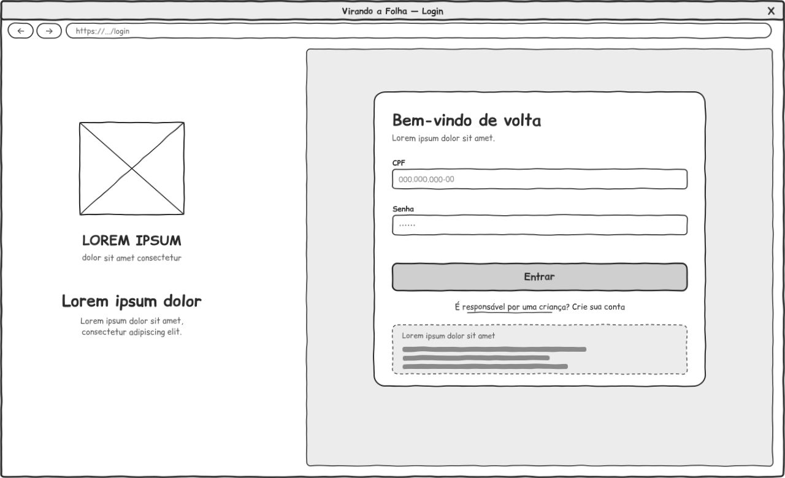

**2. Criar conta de responsável.** Cadastro do responsável (dados, telefones e senha).

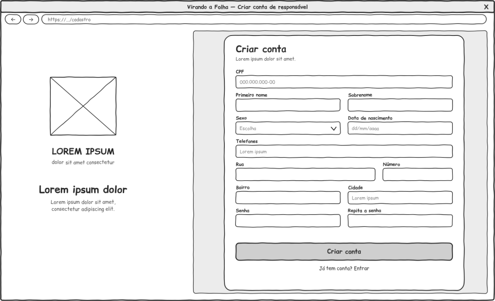

**3. Início da equipe.** Atalhos, indicadores do dia, escala de festas, crianças brincando agora e próximos eventos.


**4. Atendimentos: na brinquedoteca.** Registrar entrada (criança, recepcionista, monitores) e lista de crianças brincando agora, com saída e valor parcial.

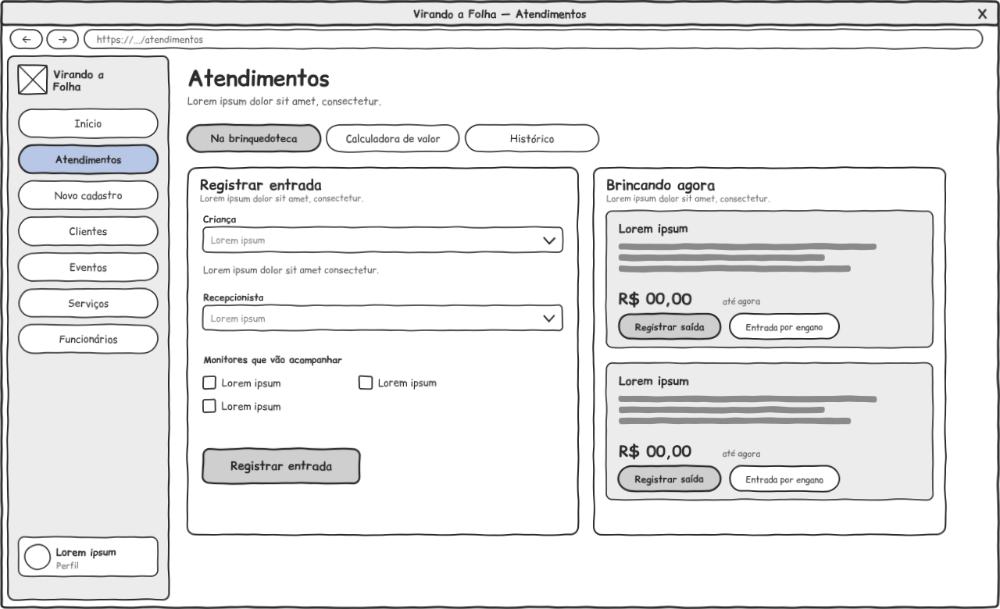

**5. Atendimentos: calculadora de valor.** Calculadora por minuto, tabela rápida e tabela de preços por faixa, com desconto de irmãos.

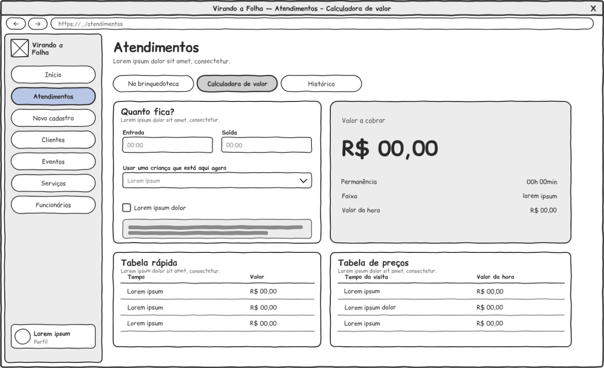

**6. Novo cadastro.** Responsável e crianças na mesma tela, com segundo responsável e observações (alergias, cuidados).

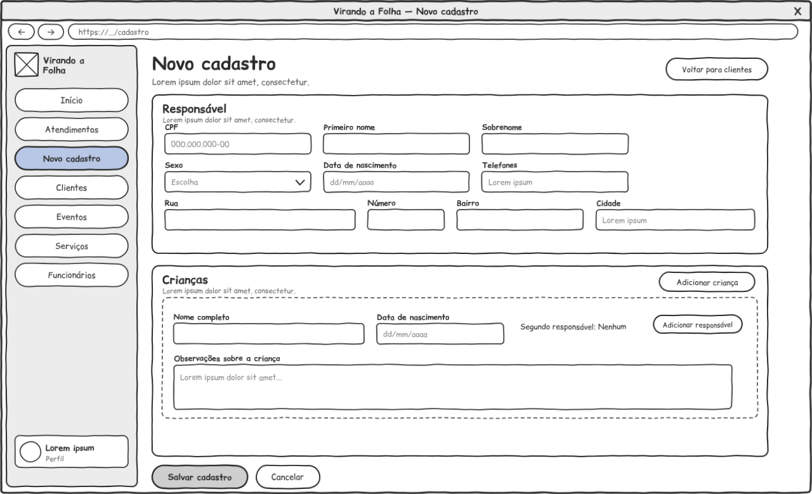

**7. Clientes.** Lista de famílias com busca, edição e inclusão de criança.

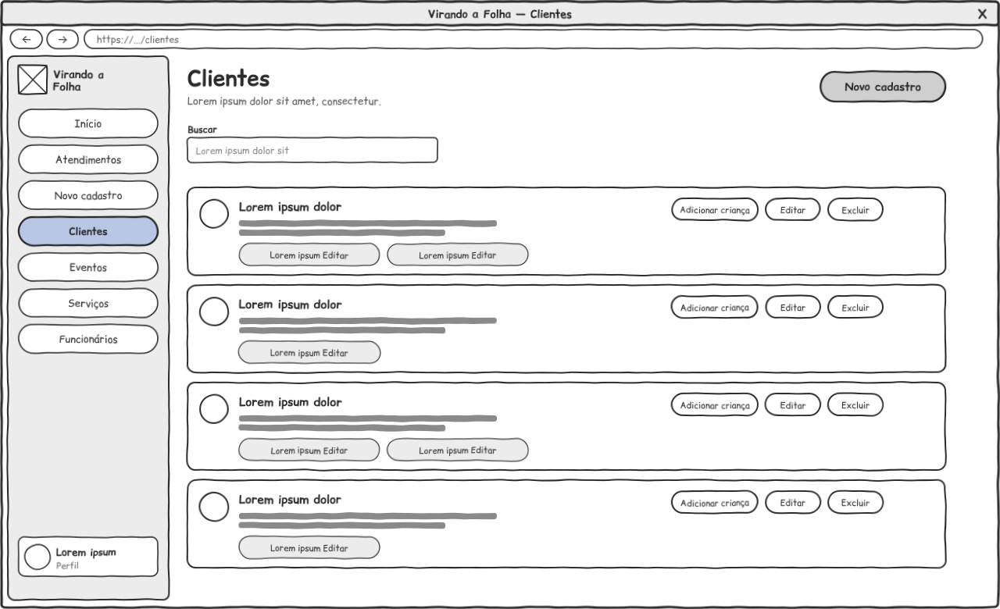

**8. Eventos.** Lista de orçamentos e festas, com filtro por situação.


**9. Evento, passo 1: dados da festa.** Responsável, data, horário, convidados e endereço.


**10. Evento, passo 3: serviços.** Serviços contratados, quantidades, valores e total do orçamento.

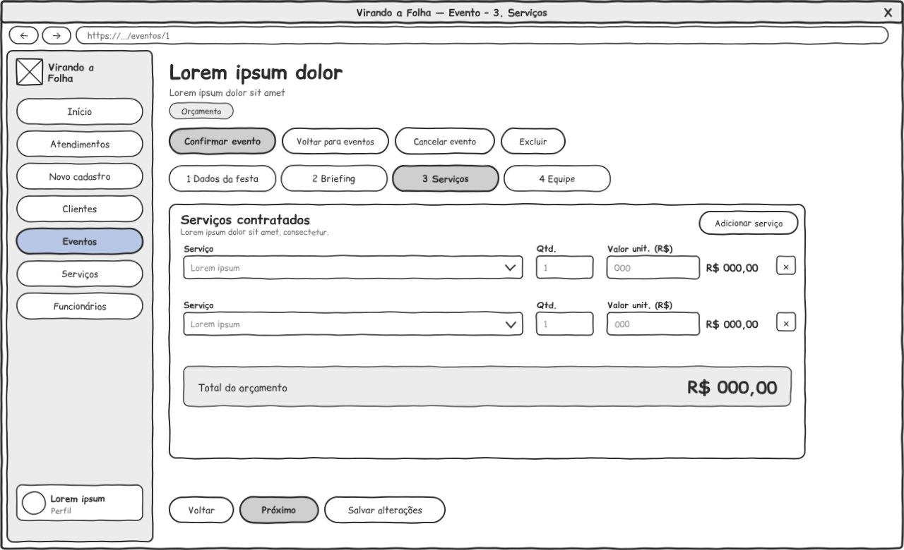

**11. Evento, passo 4: equipe e checklists.** Equipe escalada (pessoa, função e horário) e checklists de antes e depois da festa.

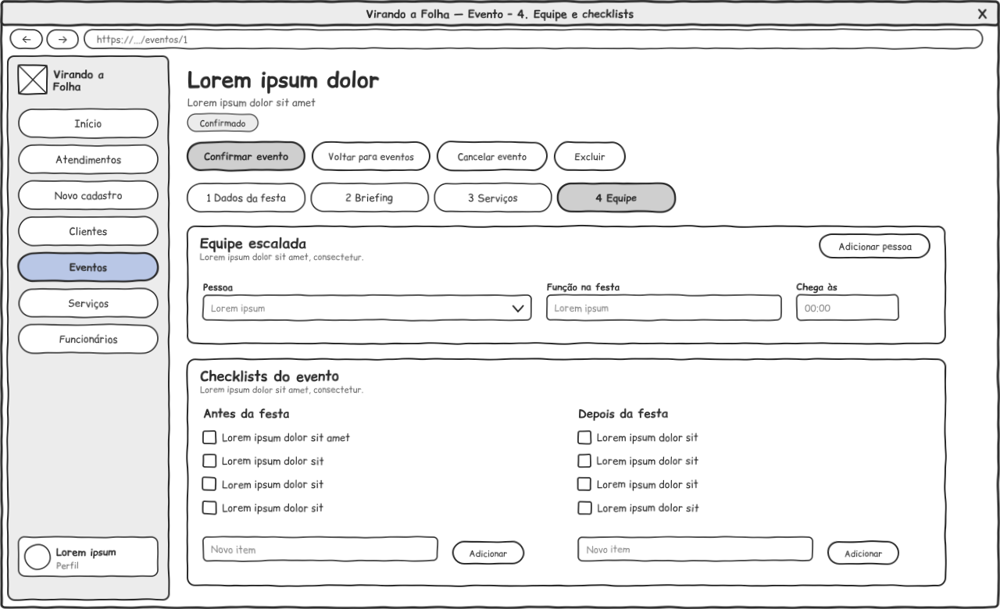

**12. Funcionários (coordenação).** Lista de funcionários, papéis, supervisor e acesso, com a janela de novo funcionário.

")

**13. Serviços (coordenação).** Catálogo de serviços das festas; só a coordenação edita.

")

**14. Início do responsável.** Atalhos, crianças cadastradas e eventos do responsável.


**15. Meus dados e crianças.** Dados do responsável e cadastro das crianças, com segundo responsável.


**16. Solicitar evento (responsável).** Pedido de festa em 3 passos: dados da festa, briefing e serviços.

")

### Diagrama de Classes

O diagrama de classes mostra como as entidades do sistema se relacionam como classes. Ele foi derivado do Modelo ER (seção [4.3.1](#431-modelo-er)): os atributos derivados viram métodos (`idade()`, `calcularValor()` e `valorTotal()`), o telefone multivalorado vira uma lista em `PESSOA` e o responsável adicional é uma associação entre `CRIANCA` e `RESPONSAVEL`.

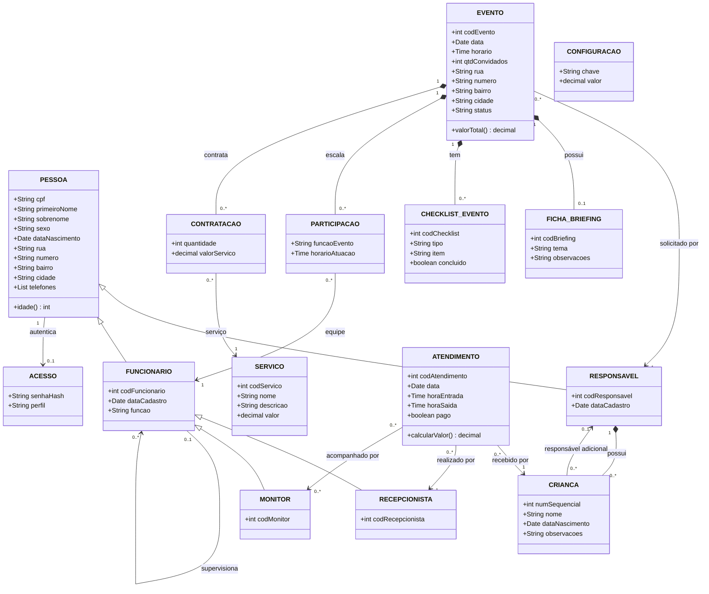

### Modelo ER

O Modelo ER do sistema está em [4.3.1 Modelo ER](#431-modelo-er).


### 4.3. Modelo de dados

O desenvolvimento da solução proposta requer a existência de bases de dados que permitam efetuar os cadastros de dados e controles associados aos processos identificados, assim como recuperações.

Um único DER dá suporte aos dois processos e ao controle de acesso. O banco tem **18 tabelas** e está na 3ª forma normal.

#### 4.3.1 Modelo ER

")

**Entidades e relacionamentos principais:**

- **PESSOA** guarda os dados comuns (CPF como chave, nome composto, sexo, data de nascimento, endereço composto, telefone multivalorado e idade derivada). Ela se especializa de forma **disjunta** em **RESPONSAVEL** e **FUNCIONARIO**: uma pessoa não é as duas coisas.
- **FUNCIONARIO** se especializa de forma **sobreposta** em **RECEPCIONISTA** e **MONITOR** (um funcionário pode ter os dois papéis) e se relaciona consigo mesmo em **SUPERVISIONA**.
- **CRIANCA** é entidade fraca de **RESPONSAVEL** (relacionamento identificador **POSSUI**); a chave parcial é `num_sequencial`. O relacionamento **ADICIONAL** liga a criança a um segundo responsável, opcional.
- **ATENDIMENTO** é **RECEBIDO** por uma criança, **REALIZADO** por um recepcionista e **ACOMPANHADO** por um ou mais monitores. O valor total é um atributo derivado (calculado pelo tempo); `pago` marca o pagamento.
- **EVENTO** é **SOLICITADO** por um responsável, **POSSUI** uma **FICHA_BRIEFING** (1:1), **TEM** itens em **CHECKLIST_EVENTO**, conta com funcionários pela entidade associativa **PARTICIPACAO** (função no evento e horário de atuação) e contrata serviços do catálogo **SERVICO** pela entidade associativa **CONTRATACAO** (quantidade e valor do serviço). O valor total do evento é derivado.
- **ACESSO** guarda o login (senha em hash e perfil) e se liga à pessoa pelo relacionamento **AUTENTICA** (no máximo um acesso por pessoa).
- **CONFIGURACAO** guarda parâmetros do sistema em pares chave e valor (por exemplo, o valor da hora).

As cardinalidades de cada relacionamento estão indicadas no próprio diagrama.

**Acréscimos do BPMN TO-BE ao modelo:** ACESSO, CHECKLIST_EVENTO, CONFIGURACAO, `ATENDIMENTO.pago` e `EVENTO.status` (orçamento, confirmado ou cancelado).

#### 4.3.2 Esquema Relacional

O Esquema Relacional corresponde à representação dos dados em tabelas juntamente com as restrições de integridade e chave primária.
 
**Esquema relacional do sistema** (diagrama de esquema). Chaves primárias sublinhadas e chaves estrangeiras em rosa; as setas apontam da tabela com a chave estrangeira para a tabela referenciada.

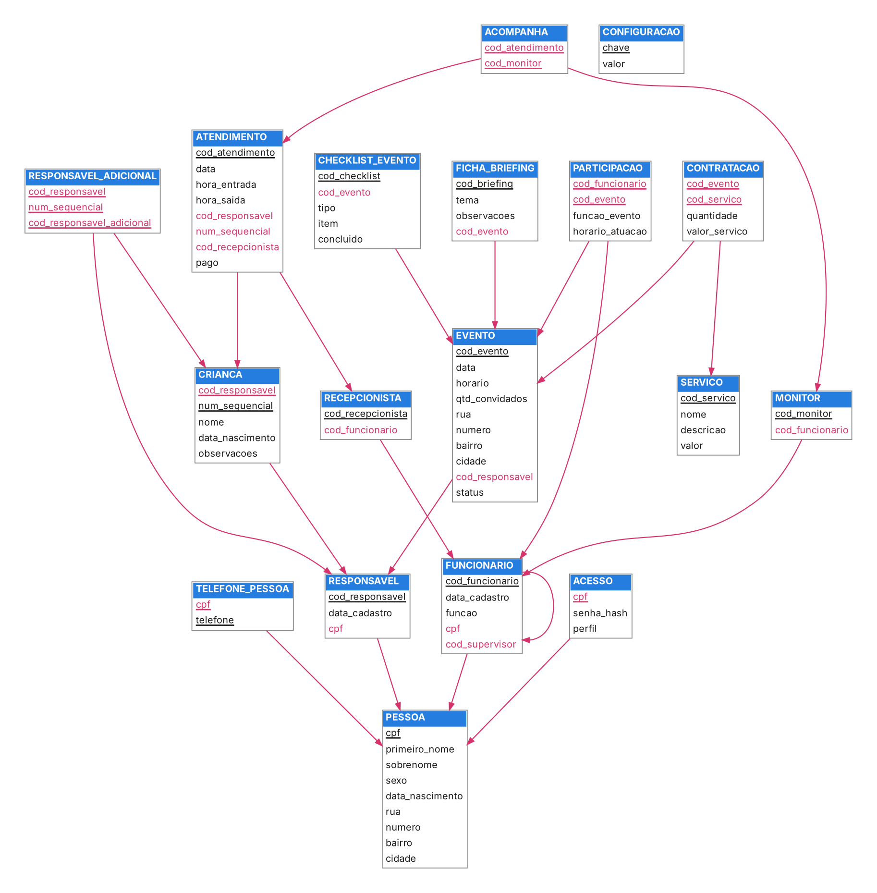

**Esquema resultante** (chaves primárias em **negrito**; chaves estrangeiras indicadas por →):

- PESSOA(**cpf**, primeiro_nome, sobrenome, sexo, data_nascimento, rua, numero, bairro, cidade)
- TELEFONE_PESSOA(**cpf** → PESSOA, **telefone**)
- ACESSO(**cpf** → PESSOA, senha_hash, perfil)
- RESPONSAVEL(**cod_responsavel**, data_cadastro, cpf → PESSOA (único))
- FUNCIONARIO(**cod_funcionario**, data_cadastro, funcao, cpf → PESSOA (único), cod_supervisor → FUNCIONARIO)
- RECEPCIONISTA(**cod_recepcionista**, cod_funcionario → FUNCIONARIO (único))
- MONITOR(**cod_monitor**, cod_funcionario → FUNCIONARIO (único))
- CRIANCA(**cod_responsavel** → RESPONSAVEL, **num_sequencial**, nome, data_nascimento, observacoes)
- RESPONSAVEL_ADICIONAL(**(cod_responsavel, num_sequencial)** → CRIANCA, **cod_responsavel_adicional** → RESPONSAVEL)
- ATENDIMENTO(**cod_atendimento**, data, hora_entrada, hora_saida, pago, (cod_responsavel, num_sequencial) → CRIANCA, cod_recepcionista → RECEPCIONISTA)
- ACOMPANHA(**cod_atendimento** → ATENDIMENTO, **cod_monitor** → MONITOR)
- EVENTO(**cod_evento**, data, horario, qtd_convidados, rua, numero, bairro, cidade, status, cod_responsavel → RESPONSAVEL)
- FICHA_BRIEFING(**cod_briefing**, tema, observacoes, cod_evento → EVENTO (único))
- CHECKLIST_EVENTO(**cod_checklist**, cod_evento → EVENTO, tipo, item, concluido)
- SERVICO(**cod_servico**, nome (único), descricao, valor)
- PARTICIPACAO(**cod_funcionario** → FUNCIONARIO, **cod_evento** → EVENTO, funcao_evento, horario_atuacao)
- CONTRATACAO(**cod_evento** → EVENTO, **cod_servico** → SERVICO, quantidade, valor_servico)
- CONFIGURACAO(**chave**, valor)

**Regras de mapeamento do MER para o relacional:**

| Regra | Onde aparece | Como foi mapeado |
| --- | --- | --- |
| Entidade forte | PESSOA, ATENDIMENTO, EVENTO, SERVICO | Uma tabela por entidade; o endereço (atributo composto) virou as colunas rua, numero, bairro e cidade |
| Entidade fraca | CRIANCA (depende de RESPONSAVEL) | Chave primária composta: `cod_responsavel` + `num_sequencial` (numerado por trigger: 1, 2, 3...) |
| Relacionamento 1:N | SUPERVISIONA, SOLICITA, REALIZA, RECEBE | A chave do lado 1 vira chave estrangeira no lado N |
| Relacionamento N:N | ACOMPANHA, PARTICIPACAO, CONTRATACAO, ADICIONAL | Tabela própria com chave composta pelas chaves estrangeiras; atributos do relacionamento vão para ela |
| Relacionamento 1:1 | EVENTO e FICHA_BRIEFING | Chave estrangeira `cod_evento` em FICHA_BRIEFING, com UNIQUE |
| Atributo multivalorado | Telefone de PESSOA | Tabela TELEFONE_PESSOA, chave (cpf, telefone) |
| Generalização/especialização | PESSOA → RESPONSAVEL e FUNCIONARIO (disjunta); FUNCIONARIO → RECEPCIONISTA e MONITOR (sobreposta) | Uma tabela para a superclasse e uma por subclasse, com chave estrangeira UNIQUE; a disjunção é garantida por triggers |

**Normalização (até a 3FN):**

- **1FN:** todos os atributos são atômicos. O endereço foi dividido em colunas, os telefones ficam em TELEFONE_PESSOA e o responsável adicional fica em RESPONSAVEL_ADICIONAL.
- **2FN:** nenhum atributo depende de parte de uma chave composta (em CRIANCA, PARTICIPACAO e CONTRATACAO, os atributos dependem do par completo).
- **3FN:** nenhum atributo não chave depende de outro não chave. Nome e endereço ficam só em PESSOA; ATENDIMENTO não guarda o valor cobrado, que é calculado pelo tempo de permanência.

O **dicionário de dados** completo das 18 tabelas está em [4-Dicionario-de-Dados.md](4-Dicionario-de-Dados.md).

#### 4.3.3 Modelo Físico

O script abaixo é o `schema.sql` do projeto, que fica em `código-fonte/db/database/schema.sql`.

##### Diagrama do modelo físico (EER)

Diagrama gerado por engenharia reversa do banco criado pelo script abaixo (linha cheia = relacionamento identificador, a FK faz parte da PK; linha tracejada = FK comum; "pé de galinha" no lado "muitos").

 do banco brinquedoteca")

##### Script de criação (DDL + triggers)

<details>
<summary>Clique para ver o script completo (<code>código-fonte/db/database/schema.sql</code>)</summary>

```sql
-- =====================================================================
-- Virando a Folha - Brinquedoteca Barreiro
-- schema.sql (MySQL 8.0) - baseado no Projeto Lógico, Fase 2 (corrigido)
-- Rode o arquivo INTEIRO (raio / Ctrl+Shift+Enter no Workbench).
-- ATENÇÃO: recria o banco do zero (apaga o que existir em "brinquedoteca").
-- =====================================================================

DROP DATABASE IF EXISTS brinquedoteca;
CREATE DATABASE brinquedoteca CHARACTER SET utf8mb4 COLLATE utf8mb4_0900_ai_ci;
USE brinquedoteca;

-- ---------------------------------------------------------------------
-- PESSOA (superclasse de RESPONSAVEL e FUNCIONARIO)
-- ---------------------------------------------------------------------
CREATE TABLE PESSOA (
  cpf             CHAR(11)     NOT NULL,
  primeiro_nome   VARCHAR(50)  NOT NULL,
  sobrenome       VARCHAR(100) NOT NULL,
  sexo            CHAR(1)      NOT NULL,
  data_nascimento DATE         NOT NULL,
  rua             VARCHAR(100) NOT NULL,
  numero          VARCHAR(10)  NOT NULL,
  bairro          VARCHAR(60)  NOT NULL,
  cidade          VARCHAR(60)  NOT NULL,
  PRIMARY KEY (cpf),
  CONSTRAINT ck_pessoa_cpf  CHECK (cpf REGEXP '^[0-9]{11}$'),
  CONSTRAINT ck_pessoa_sexo CHECK (sexo IN ('M','F','O'))
) ENGINE=InnoDB;

-- ---------------------------------------------------------------------
-- TELEFONE_PESSOA (atributo multivalorado de PESSOA)
-- ---------------------------------------------------------------------
CREATE TABLE TELEFONE_PESSOA (
  cpf      CHAR(11)    NOT NULL,
  telefone VARCHAR(15) NOT NULL,
  PRIMARY KEY (cpf, telefone),
  CONSTRAINT fk_telpessoa_pessoa FOREIGN KEY (cpf) REFERENCES PESSOA (cpf)
    ON DELETE CASCADE ON UPDATE CASCADE,
  CONSTRAINT ck_telpessoa_tel CHECK (telefone REGEXP '^[0-9]{1,15}$')
) ENGINE=InnoDB;

-- ---------------------------------------------------------------------
-- RESPONSAVEL (especializacao de PESSOA)
-- ---------------------------------------------------------------------
CREATE TABLE RESPONSAVEL (
  cod_responsavel INT      NOT NULL AUTO_INCREMENT,
  data_cadastro   DATE     NOT NULL DEFAULT (CURRENT_DATE),
  cpf             CHAR(11) NOT NULL,
  PRIMARY KEY (cod_responsavel),
  UNIQUE KEY uq_responsavel_cpf (cpf),
  CONSTRAINT fk_responsavel_pessoa FOREIGN KEY (cpf) REFERENCES PESSOA (cpf)
    ON DELETE RESTRICT ON UPDATE CASCADE
) ENGINE=InnoDB;

-- ---------------------------------------------------------------------
-- FUNCIONARIO (especializacao de PESSOA, com autorrelacionamento)
-- ---------------------------------------------------------------------
CREATE TABLE FUNCIONARIO (
  cod_funcionario INT         NOT NULL AUTO_INCREMENT,
  data_cadastro   DATE        NOT NULL DEFAULT (CURRENT_DATE),
  funcao          VARCHAR(50) NOT NULL,
  cpf             CHAR(11)    NOT NULL,
  cod_supervisor  INT         NULL DEFAULT NULL,
  PRIMARY KEY (cod_funcionario),
  UNIQUE KEY uq_funcionario_cpf (cpf),
  CONSTRAINT fk_funcionario_pessoa FOREIGN KEY (cpf) REFERENCES PESSOA (cpf)
    ON DELETE RESTRICT ON UPDATE CASCADE,
  CONSTRAINT fk_funcionario_supervisor FOREIGN KEY (cod_supervisor) REFERENCES FUNCIONARIO (cod_funcionario)
    ON DELETE SET NULL ON UPDATE CASCADE
) ENGINE=InnoDB;
-- (supervisor <> proprio funcionario e controlado por trigger, mais abaixo)

-- ---------------------------------------------------------------------
-- RECEPCIONISTA e MONITOR (especializacoes sobrepostas de FUNCIONARIO)
-- ---------------------------------------------------------------------
CREATE TABLE RECEPCIONISTA (
  cod_recepcionista INT NOT NULL AUTO_INCREMENT,
  cod_funcionario   INT NOT NULL,
  PRIMARY KEY (cod_recepcionista),
  UNIQUE KEY uq_recepcionista_func (cod_funcionario),
  CONSTRAINT fk_recepcionista_func FOREIGN KEY (cod_funcionario) REFERENCES FUNCIONARIO (cod_funcionario)
    ON DELETE CASCADE ON UPDATE CASCADE
) ENGINE=InnoDB;

CREATE TABLE MONITOR (
  cod_monitor     INT NOT NULL AUTO_INCREMENT,
  cod_funcionario INT NOT NULL,
  PRIMARY KEY (cod_monitor),
  UNIQUE KEY uq_monitor_func (cod_funcionario),
  CONSTRAINT fk_monitor_func FOREIGN KEY (cod_funcionario) REFERENCES FUNCIONARIO (cod_funcionario)
    ON DELETE CASCADE ON UPDATE CASCADE
) ENGINE=InnoDB;

-- ---------------------------------------------------------------------
-- CRIANCA (entidade fraca de RESPONSAVEL)
-- PK = (cod_responsavel, num_sequencial). Se o num_sequencial nao for
-- informado no INSERT, um trigger numera automaticamente (1, 2, 3...).
-- ---------------------------------------------------------------------
CREATE TABLE CRIANCA (
  cod_responsavel INT          NOT NULL,
  num_sequencial  INT          NOT NULL DEFAULT 0,
  nome            VARCHAR(100) NOT NULL,
  data_nascimento DATE         NOT NULL,
  observacoes     VARCHAR(255) NULL DEFAULT NULL,
  PRIMARY KEY (cod_responsavel, num_sequencial),
  CONSTRAINT fk_crianca_responsavel FOREIGN KEY (cod_responsavel) REFERENCES RESPONSAVEL (cod_responsavel)
    ON DELETE CASCADE ON UPDATE CASCADE
) ENGINE=InnoDB;

-- ---------------------------------------------------------------------
-- RESPONSAVEL_ADICIONAL (2o responsavel, opcional, de uma crianca)
-- Regras (adicional <> principal e maximo de 1 adicional): triggers.
-- ---------------------------------------------------------------------
CREATE TABLE RESPONSAVEL_ADICIONAL (
  cod_responsavel           INT NOT NULL,
  num_sequencial            INT NOT NULL,
  cod_responsavel_adicional INT NOT NULL,
  PRIMARY KEY (cod_responsavel, num_sequencial, cod_responsavel_adicional),
  CONSTRAINT fk_respadic_crianca FOREIGN KEY (cod_responsavel, num_sequencial)
    REFERENCES CRIANCA (cod_responsavel, num_sequencial)
    ON DELETE CASCADE ON UPDATE CASCADE,
  CONSTRAINT fk_respadic_responsavel FOREIGN KEY (cod_responsavel_adicional)
    REFERENCES RESPONSAVEL (cod_responsavel)
    ON DELETE RESTRICT ON UPDATE CASCADE
) ENGINE=InnoDB;

-- ---------------------------------------------------------------------
-- ATENDIMENTO (entrada e saida de uma crianca)
-- hora_saida fica NULL enquanto a crianca esta na brinquedoteca.
-- ACRESCIMO: coluna "pago" (confirmar pagamento, do BPMN TO-BE).
-- ---------------------------------------------------------------------
CREATE TABLE ATENDIMENTO (
  cod_atendimento   INT     NOT NULL AUTO_INCREMENT,
  data              DATE    NOT NULL DEFAULT (CURRENT_DATE),
  hora_entrada      TIME    NOT NULL,
  hora_saida        TIME    NULL DEFAULT NULL,
  cod_responsavel   INT     NOT NULL,
  num_sequencial    INT     NOT NULL,
  cod_recepcionista INT     NOT NULL,
  pago              BOOLEAN NOT NULL DEFAULT FALSE,   -- ACRESCIMO
  PRIMARY KEY (cod_atendimento),
  CONSTRAINT fk_atend_crianca FOREIGN KEY (cod_responsavel, num_sequencial)
    REFERENCES CRIANCA (cod_responsavel, num_sequencial)
    ON DELETE RESTRICT ON UPDATE CASCADE,
  CONSTRAINT fk_atend_recepcionista FOREIGN KEY (cod_recepcionista)
    REFERENCES RECEPCIONISTA (cod_recepcionista)
    ON DELETE RESTRICT ON UPDATE CASCADE,
  CONSTRAINT ck_atend_saida CHECK (hora_saida IS NULL OR hora_saida > hora_entrada)
) ENGINE=InnoDB;

-- ---------------------------------------------------------------------
-- ACOMPANHA (N:N entre MONITOR e ATENDIMENTO)
-- ---------------------------------------------------------------------
CREATE TABLE ACOMPANHA (
  cod_atendimento INT NOT NULL,
  cod_monitor     INT NOT NULL,
  PRIMARY KEY (cod_atendimento, cod_monitor),
  CONSTRAINT fk_acompanha_atend FOREIGN KEY (cod_atendimento) REFERENCES ATENDIMENTO (cod_atendimento)
    ON DELETE CASCADE ON UPDATE CASCADE,
  CONSTRAINT fk_acompanha_monitor FOREIGN KEY (cod_monitor) REFERENCES MONITOR (cod_monitor)
    ON DELETE RESTRICT ON UPDATE CASCADE
) ENGINE=InnoDB;

-- ---------------------------------------------------------------------
-- EVENTO (festas e atividades tematicas)
-- ACRESCIMO: coluna "status" (orcamento aprovado ou nao, do BPMN TO-BE).
-- ---------------------------------------------------------------------
CREATE TABLE EVENTO (
  cod_evento      INT          NOT NULL AUTO_INCREMENT,
  data            DATE         NOT NULL,
  horario         TIME         NOT NULL,
  qtd_convidados  INT          NOT NULL,
  rua             VARCHAR(100) NOT NULL,
  numero          VARCHAR(10)  NOT NULL,
  bairro          VARCHAR(60)  NOT NULL,
  cidade          VARCHAR(60)  NOT NULL,
  cod_responsavel INT          NOT NULL,
  status          ENUM('ORCAMENTO','CONFIRMADO','CANCELADO') NOT NULL DEFAULT 'ORCAMENTO',  -- ACRESCIMO
  PRIMARY KEY (cod_evento),
  CONSTRAINT fk_evento_responsavel FOREIGN KEY (cod_responsavel) REFERENCES RESPONSAVEL (cod_responsavel)
    ON DELETE RESTRICT ON UPDATE CASCADE,
  CONSTRAINT ck_evento_convidados CHECK (qtd_convidados > 0)
) ENGINE=InnoDB;

-- ---------------------------------------------------------------------
-- FICHA_BRIEFING (1:1 com EVENTO)
-- ---------------------------------------------------------------------
CREATE TABLE FICHA_BRIEFING (
  cod_briefing INT          NOT NULL AUTO_INCREMENT,
  tema         VARCHAR(100) NOT NULL,
  observacoes  VARCHAR(255) NULL DEFAULT NULL,
  cod_evento   INT          NOT NULL,
  PRIMARY KEY (cod_briefing),
  UNIQUE KEY uq_briefing_evento (cod_evento),
  CONSTRAINT fk_briefing_evento FOREIGN KEY (cod_evento) REFERENCES EVENTO (cod_evento)
    ON DELETE CASCADE ON UPDATE CASCADE
) ENGINE=InnoDB;

-- ---------------------------------------------------------------------
-- SERVICO (catalogo)
-- ---------------------------------------------------------------------
CREATE TABLE SERVICO (
  cod_servico INT           NOT NULL AUTO_INCREMENT,
  nome        VARCHAR(100)  NOT NULL,
  descricao   VARCHAR(255)  NULL DEFAULT NULL,
  valor       DECIMAL(10,2) NOT NULL DEFAULT 0.00,
  PRIMARY KEY (cod_servico),
  UNIQUE KEY uq_servico_nome (nome),
  CONSTRAINT ck_servico_valor CHECK (valor >= 0)
) ENGINE=InnoDB;

-- ---------------------------------------------------------------------
-- PARTICIPACAO (N:N entre FUNCIONARIO e EVENTO)
-- ---------------------------------------------------------------------
CREATE TABLE PARTICIPACAO (
  cod_funcionario INT         NOT NULL,
  cod_evento      INT         NOT NULL,
  funcao_evento   VARCHAR(50) NOT NULL,
  horario_atuacao TIME        NOT NULL,
  PRIMARY KEY (cod_funcionario, cod_evento),
  CONSTRAINT fk_partic_funcionario FOREIGN KEY (cod_funcionario) REFERENCES FUNCIONARIO (cod_funcionario)
    ON DELETE RESTRICT ON UPDATE CASCADE,
  CONSTRAINT fk_partic_evento FOREIGN KEY (cod_evento) REFERENCES EVENTO (cod_evento)
    ON DELETE CASCADE ON UPDATE CASCADE
) ENGINE=InnoDB;

-- ---------------------------------------------------------------------
-- CONTRATACAO (N:N entre EVENTO e SERVICO)
-- ---------------------------------------------------------------------
CREATE TABLE CONTRATACAO (
  cod_evento    INT           NOT NULL,
  cod_servico   INT           NOT NULL,
  quantidade    INT           NOT NULL DEFAULT 1,
  valor_servico DECIMAL(10,2) NOT NULL,
  PRIMARY KEY (cod_evento, cod_servico),
  CONSTRAINT fk_contrat_evento FOREIGN KEY (cod_evento) REFERENCES EVENTO (cod_evento)
    ON DELETE CASCADE ON UPDATE CASCADE,
  CONSTRAINT fk_contrat_servico FOREIGN KEY (cod_servico) REFERENCES SERVICO (cod_servico)
    ON DELETE RESTRICT ON UPDATE CASCADE,
  CONSTRAINT ck_contrat_qtd   CHECK (quantidade > 0),
  CONSTRAINT ck_contrat_valor CHECK (valor_servico >= 0)
) ENGINE=InnoDB;

-- =====================================================================
-- ACRESCIMOS (nao estao no Projeto Logico; vieram do BPMN TO-BE)
-- =====================================================================

-- Configuracoes do sistema (ex.: valor da hora para calcular a cobranca
-- do atendimento: valor = horas de permanencia x valor_hora)
CREATE TABLE CONFIGURACAO (
  chave VARCHAR(50)   NOT NULL,
  valor DECIMAL(10,2) NOT NULL,
  PRIMARY KEY (chave)
) ENGINE=InnoDB;

-- Acesso ao sistema (login): CPF + senha guardada em hash (nunca a senha pura).
-- perfil: ADMIN = coordenacao, FUNCIONARIO = equipe, RESPONSAVEL = cliente que criou conta no site.
-- Apagou a PESSOA, o acesso dela vai junto (CASCADE).
CREATE TABLE ACESSO (
  cpf        CHAR(11)     NOT NULL,
  senha_hash VARCHAR(200) NOT NULL,
  perfil     VARCHAR(12)  NOT NULL,
  PRIMARY KEY (cpf),
  CONSTRAINT fk_acesso_pessoa FOREIGN KEY (cpf) REFERENCES PESSOA (cpf) ON DELETE CASCADE,
  CONSTRAINT ck_acesso_perfil CHECK (perfil IN ('ADMIN', 'FUNCIONARIO', 'RESPONSAVEL'))
) ENGINE=InnoDB;

-- Checklists pre e pos-evento
CREATE TABLE CHECKLIST_EVENTO (
  cod_checklist INT          NOT NULL AUTO_INCREMENT,
  cod_evento    INT          NOT NULL,
  tipo          ENUM('PRE','POS') NOT NULL,
  item          VARCHAR(150) NOT NULL,
  concluido     BOOLEAN      NOT NULL DEFAULT FALSE,
  PRIMARY KEY (cod_checklist),
  CONSTRAINT fk_checklist_evento FOREIGN KEY (cod_evento) REFERENCES EVENTO (cod_evento)
    ON DELETE CASCADE ON UPDATE CASCADE
) ENGINE=InnoDB;

-- =====================================================================
-- TRIGGERS (regras que o CHECK do MySQL nao consegue fazer)
-- No Workbench o DELIMITER abaixo funciona normalmente.
-- =====================================================================
DELIMITER $$

-- Data de nascimento nao pode estar no futuro (PESSOA)
CREATE TRIGGER trg_pessoa_bi BEFORE INSERT ON PESSOA FOR EACH ROW
BEGIN
  IF NEW.data_nascimento > CURRENT_DATE THEN
    SIGNAL SQLSTATE '45000' SET MESSAGE_TEXT = 'Data de nascimento nao pode ser futura.';
  END IF;
END$$

CREATE TRIGGER trg_pessoa_bu BEFORE UPDATE ON PESSOA FOR EACH ROW
BEGIN
  IF NEW.data_nascimento > CURRENT_DATE THEN
    SIGNAL SQLSTATE '45000' SET MESSAGE_TEXT = 'Data de nascimento nao pode ser futura.';
  END IF;
END$$

-- Disjuncao: uma pessoa nao pode ser RESPONSAVEL e FUNCIONARIO ao mesmo tempo
CREATE TRIGGER trg_responsavel_bi BEFORE INSERT ON RESPONSAVEL FOR EACH ROW
BEGIN
  IF EXISTS (SELECT 1 FROM FUNCIONARIO WHERE cpf = NEW.cpf) THEN
    SIGNAL SQLSTATE '45000' SET MESSAGE_TEXT = 'Esta pessoa ja e funcionario e nao pode ser responsavel.';
  END IF;
END$$

CREATE TRIGGER trg_funcionario_bi BEFORE INSERT ON FUNCIONARIO FOR EACH ROW
BEGIN
  IF EXISTS (SELECT 1 FROM RESPONSAVEL WHERE cpf = NEW.cpf) THEN
    SIGNAL SQLSTATE '45000' SET MESSAGE_TEXT = 'Esta pessoa ja e responsavel e nao pode ser funcionario.';
  END IF;
  IF NEW.cod_supervisor IS NOT NULL AND NEW.cod_supervisor = NEW.cod_funcionario THEN
    SIGNAL SQLSTATE '45000' SET MESSAGE_TEXT = 'Funcionario nao pode supervisionar a si mesmo.';
  END IF;
END$$

CREATE TRIGGER trg_funcionario_bu BEFORE UPDATE ON FUNCIONARIO FOR EACH ROW
BEGIN
  IF NEW.cod_supervisor IS NOT NULL AND NEW.cod_supervisor = NEW.cod_funcionario THEN
    SIGNAL SQLSTATE '45000' SET MESSAGE_TEXT = 'Funcionario nao pode supervisionar a si mesmo.';
  END IF;
END$$

-- CRIANCA: numera automaticamente (1, 2, 3...) por responsavel quando
-- o num_sequencial nao e informado; e impede data de nascimento futura
CREATE TRIGGER trg_crianca_bi BEFORE INSERT ON CRIANCA FOR EACH ROW
BEGIN
  IF NEW.num_sequencial IS NULL OR NEW.num_sequencial = 0 THEN
    SET NEW.num_sequencial = (SELECT COALESCE(MAX(num_sequencial), 0) + 1
                              FROM CRIANCA WHERE cod_responsavel = NEW.cod_responsavel);
  END IF;
  IF NEW.data_nascimento > CURRENT_DATE THEN
    SIGNAL SQLSTATE '45000' SET MESSAGE_TEXT = 'Data de nascimento da crianca nao pode ser futura.';
  END IF;
END$$

CREATE TRIGGER trg_crianca_bu BEFORE UPDATE ON CRIANCA FOR EACH ROW
BEGIN
  IF NEW.data_nascimento > CURRENT_DATE THEN
    SIGNAL SQLSTATE '45000' SET MESSAGE_TEXT = 'Data de nascimento da crianca nao pode ser futura.';
  END IF;
END$$

-- RESPONSAVEL_ADICIONAL: o adicional deve ser outra pessoa que o principal
-- e cada crianca so pode ter 1 adicional (maximo de 2 responsaveis)
CREATE TRIGGER trg_respadic_bi BEFORE INSERT ON RESPONSAVEL_ADICIONAL FOR EACH ROW
BEGIN
  IF NEW.cod_responsavel_adicional = NEW.cod_responsavel THEN
    SIGNAL SQLSTATE '45000' SET MESSAGE_TEXT = 'O responsavel adicional deve ser diferente do principal.';
  END IF;
  IF EXISTS (SELECT 1 FROM RESPONSAVEL_ADICIONAL
             WHERE cod_responsavel = NEW.cod_responsavel
               AND num_sequencial  = NEW.num_sequencial) THEN
    SIGNAL SQLSTATE '45000' SET MESSAGE_TEXT = 'A crianca ja possui 2 responsaveis (limite maximo).';
  END IF;
END$$

CREATE TRIGGER trg_respadic_bu BEFORE UPDATE ON RESPONSAVEL_ADICIONAL FOR EACH ROW
BEGIN
  IF NEW.cod_responsavel_adicional = NEW.cod_responsavel THEN
    SIGNAL SQLSTATE '45000' SET MESSAGE_TEXT = 'O responsavel adicional deve ser diferente do principal.';
  END IF;
END$$

-- ATENDIMENTO: data nao pode ser futura
CREATE TRIGGER trg_atendimento_bi BEFORE INSERT ON ATENDIMENTO FOR EACH ROW
BEGIN
  IF NEW.data > CURRENT_DATE THEN
    SIGNAL SQLSTATE '45000' SET MESSAGE_TEXT = 'Data do atendimento nao pode ser futura.';
  END IF;
END$$

-- Cadastro de crianca exige ao menos 1 responsavel: ja garantido pela
-- propria chave (cod_responsavel faz parte da PK de CRIANCA).

DELIMITER ;
```

</details>

**Triggers criados (10):** data de nascimento não futura (PESSOA e CRIANCA, na inclusão e na alteração); disjunção RESPONSAVEL/FUNCIONARIO (na inclusão); funcionário não pode supervisionar a si mesmo; numeração automática de `num_sequencial` da CRIANCA; responsável adicional diferente do principal e no máximo um por criança; data do atendimento não futura (na inclusão).


### 4.4. Tecnologias

As tecnologias usadas no projeto são:

| **Dimensão**   | **Tecnologia**  |
| ---            | ---             |
| SGBD           | MySQL 8 (consultas e modelagem no MySQL Workbench) |
| Front end      | HTML + CSS + JavaScript (requisições com `fetch`) |
| Back end       | Node.js (versão 18 ou superior) + Express 5 |
| Acesso ao banco | `mysql2` (pool de conexões) |
| Configuração   | `dotenv` (arquivo `.env`) |
| Senhas e sessão | Hash `scrypt` (módulo `crypto` nativo do Node.js) e sessão por cookie |
| Controle de versão | Git e GitHub |
| Modelagem de processos | BPMN (ferramenta da disciplina) |
| Deploy         | Execução local |

A figura que mostra como as tecnologias se relacionam é o diagrama da seção [4.1](#41-arquitetura-da-solução).