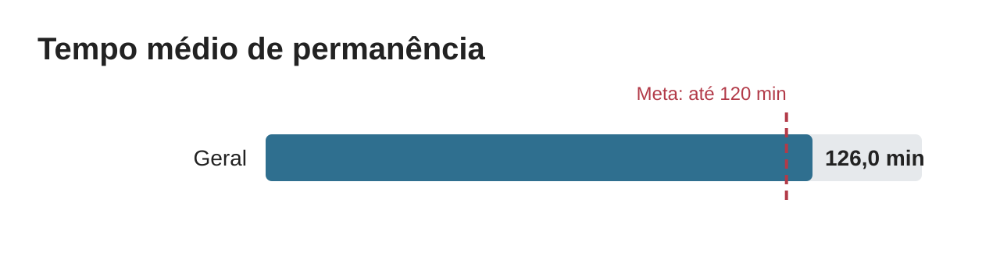
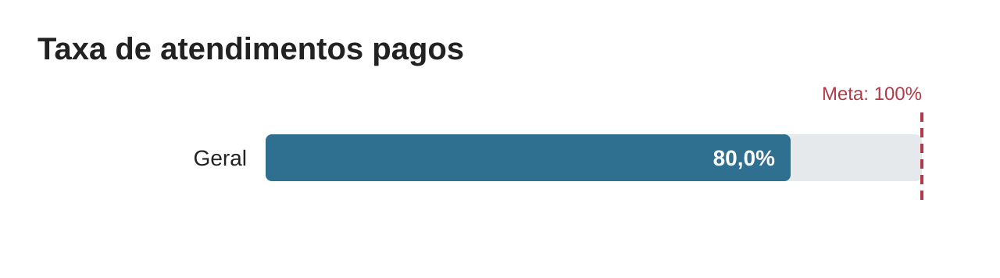
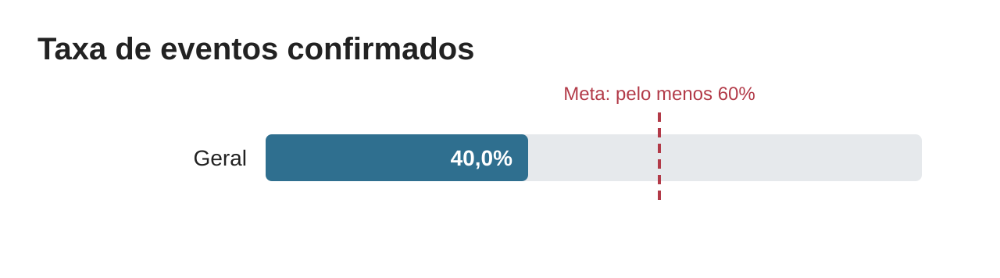
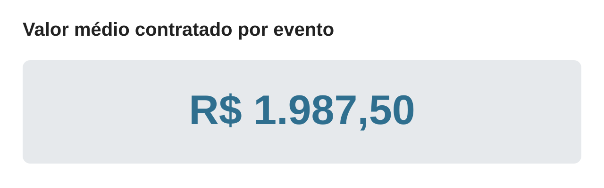
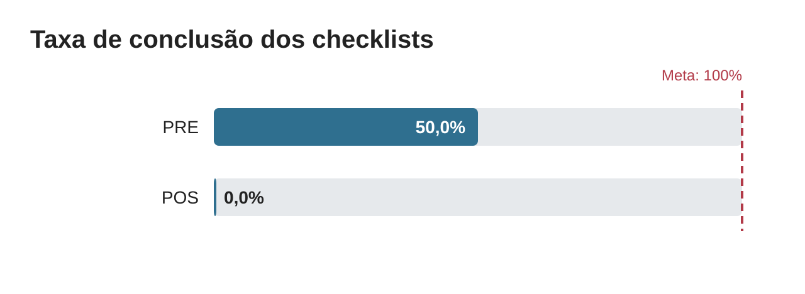

## 7. Indicadores de desempenho

Os indicadores abaixo acompanham os dois processos modelados da Brinquedoteca: o atendimento das crianças (Processo 1) e a contratação de eventos (Processo 2). Todas as informações necessárias para calculá-los estão no modelo relacional.

| **Indicador** | **Objetivos** | **Descrição** | **Fonte de dados** | **Fórmula de cálculo** | **Meta** |
| --- | --- | --- | --- | --- | --- |
| Tempo médio de permanência | Acompanhar quanto tempo as crianças ficam e a demanda do atendimento (Processo 1) | Média, em minutos, do tempo entre a entrada e a saída dos atendimentos finalizados | Tabela ATENDIMENTO (`hora_entrada`, `hora_saida`) | soma dos minutos de permanência / número de atendimentos finalizados | Até 120 min por atendimento |
| Taxa de atendimentos pagos | Controlar o que já foi cobrado e recebido na saída (Processo 1) | Percentual de atendimentos finalizados com pagamento confirmado | Tabela ATENDIMENTO (`pago`, `hora_saida`) | (atendimentos finalizados com `pago` verdadeiro / atendimentos finalizados) * 100 | 100%, pois o pagamento é feito na saída |
| Taxa de eventos confirmados | Medir quantos orçamentos de festa viram eventos confirmados (Processo 2) | Percentual de eventos com situação CONFIRMADO em relação a todos os eventos solicitados | Tabela EVENTO (`status`) | (eventos CONFIRMADO / total de eventos) * 100 | Pelo menos 60% dos orçamentos confirmados |
| Valor médio contratado por evento | Entender o tamanho dos orçamentos e os serviços mais procurados (Processo 2) | Média do total de serviços contratados por evento (quantidade x valor praticado) | Tabelas CONTRATACAO (`quantidade`, `valor_servico`) e EVENTO | soma de (quantidade x valor_servico) / número de eventos com serviços contratados | Valor mínimo por evento a definir com a Brinquedoteca |
| Taxa de conclusão dos checklists | Verificar se a equipe confere o espaço antes e depois das festas (Processo 2) | Percentual de itens de checklist concluídos, por tipo (pré ou pós-evento) | Tabela CHECKLIST_EVENTO (`tipo`, `concluido`) | (itens concluídos / total de itens) * 100 | 100% dos itens, nos dois tipos |

Todas as informações usadas estão no modelo relacional, como mostram as consultas abaixo (MySQL):

```sql
-- 1. Tempo médio de permanência (minutos)
SELECT ROUND(AVG(TIME_TO_SEC(TIMEDIFF(hora_saida, hora_entrada)) / 60), 1) AS tempo_medio_min
FROM ATENDIMENTO
WHERE hora_saida IS NOT NULL;

-- 2. Taxa de atendimentos pagos (%)
SELECT ROUND(100 * SUM(pago) / COUNT(*), 1) AS taxa_pagos_pct
FROM ATENDIMENTO
WHERE hora_saida IS NOT NULL;

-- 3. Taxa de eventos confirmados (%)
SELECT ROUND(100 * SUM(status = 'CONFIRMADO') / COUNT(*), 1) AS taxa_confirmados_pct
FROM EVENTO;

-- 4. Valor médio contratado por evento (R$)
SELECT ROUND(SUM(quantidade * valor_servico) / COUNT(DISTINCT cod_evento), 2) AS valor_medio_evento
FROM CONTRATACAO;

-- 5. Taxa de conclusão dos checklists (%), por tipo
SELECT tipo, ROUND(100 * SUM(concluido) / COUNT(*), 1) AS taxa_conclusao_pct
FROM CHECKLIST_EVENTO
GROUP BY tipo;
```

### 7.1. Gráficos dos Indicadores de desempenho

Os gráficos foram gerados a partir do resultado das consultas acima, com o banco preenchido.

**Tempo médio de permanência**



**Taxa de atendimentos pagos**



**Taxa de eventos confirmados**



**Valor médio contratado por evento**



**Taxa de conclusão dos checklists**

