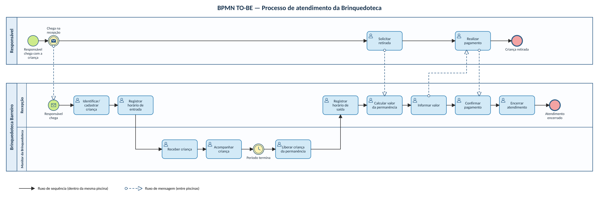
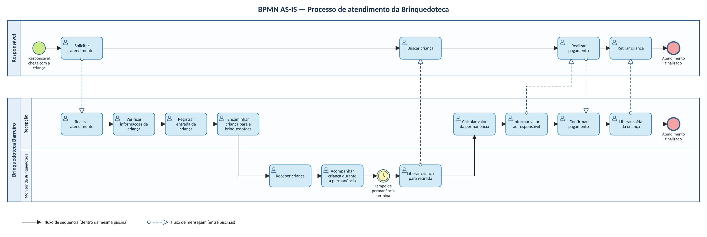
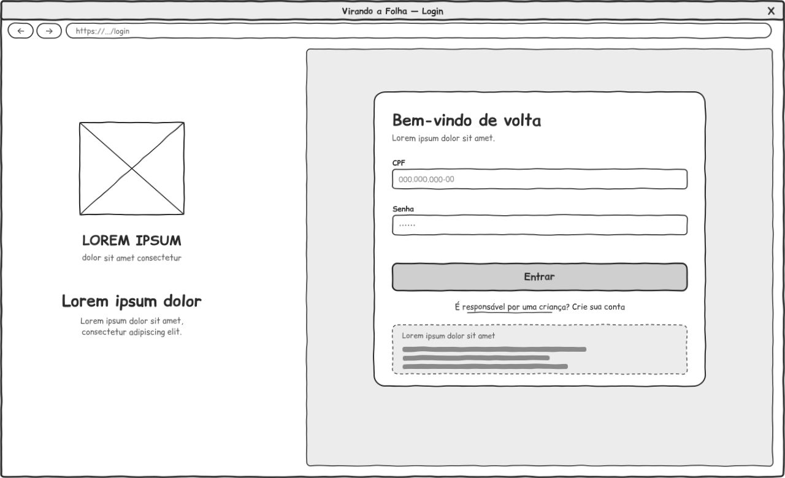
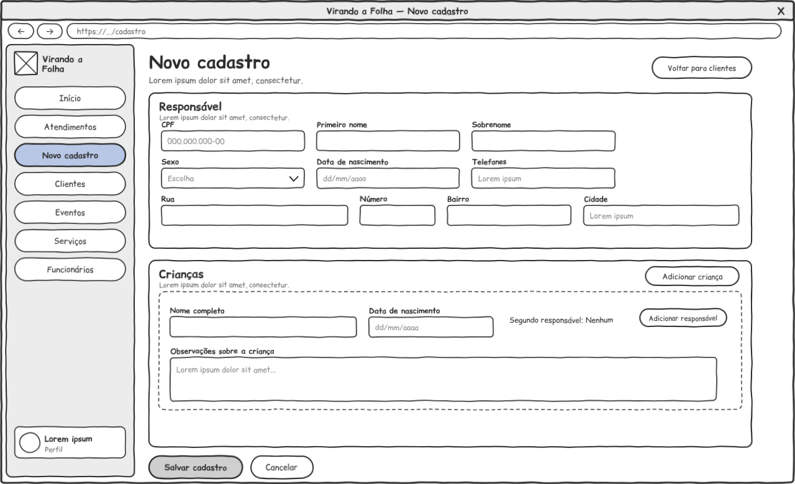
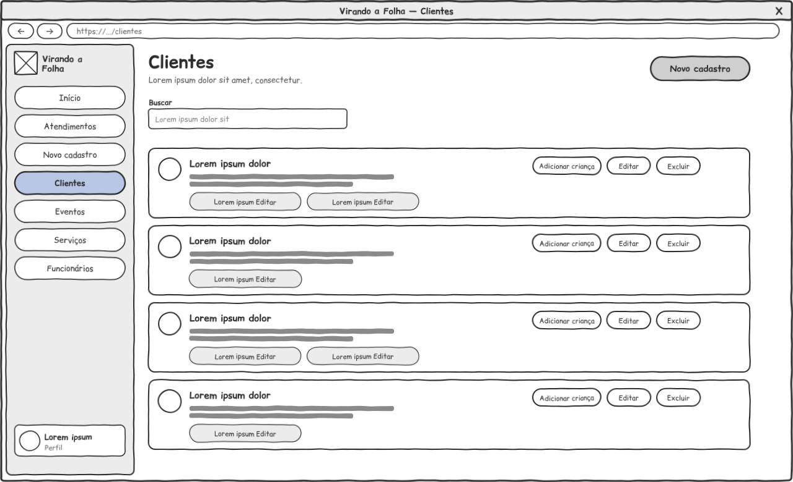
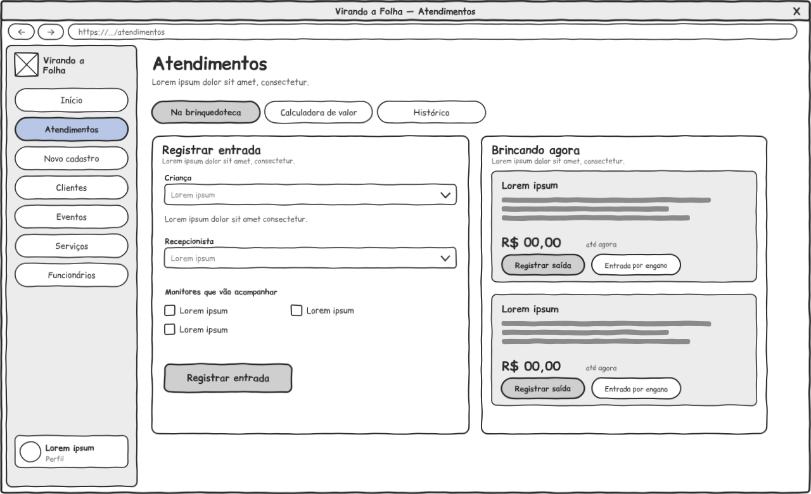
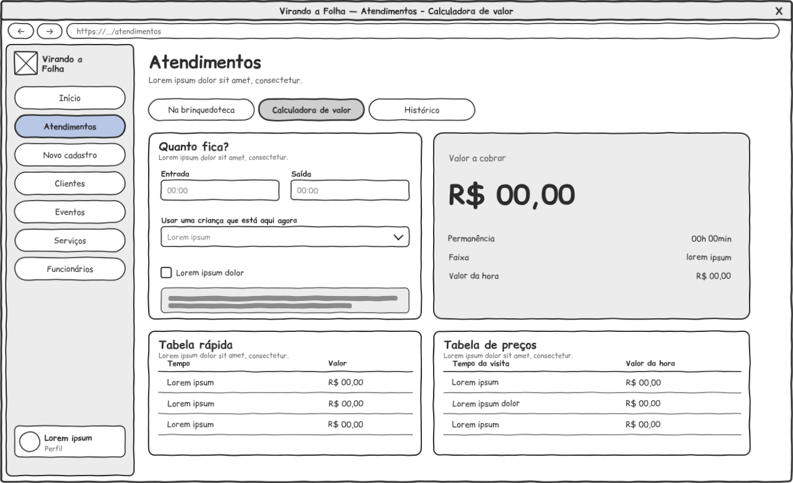

### 3.3.1 Processo 1 – Atendimento, permanência e saída da criança

O processo acontece na **Brinquedoteca Barreiro** (Rua Rodolfo Jacob, 76 – Barreiro, Belo Horizonte – MG), na recepção e no salão de brincadeiras. A recepção usa o sistema **Virando a Folha** em um computador do balcão para registrar a criança, marcar os horários e calcular a cobrança.

**Quem participa**

| Raia (BPMN) | Quem é | Perfil no sistema |
| --- | --- | --- |
| Responsável | Pai, mãe ou pessoa que leva a criança e paga a permanência | Não usa o sistema neste processo |
| Recepção | Recepcionista (ou a coordenação) que cadastra, registra entrada e saída e confirma o pagamento | `FUNCIONARIO` (recepção) ou `ADMIN` (coordenação) |
| Monitor da Brinquedoteca | Funcionário que recebe e acompanha a criança durante a brincadeira | `FUNCIONARIO` (monitoria) |

**Início:** o responsável chega à brinquedoteca com a criança.

**Fim:** a criança é retirada, depois de o valor ser informado e o pagamento confirmado (evento final "Criança retirada").

**Tarefas (modelo TO-BE):**

1. A recepção identifica a criança ou, se for a primeira visita, cadastra o responsável e a criança.
2. A recepção registra o horário de entrada, escolhe os monitores que vão acompanhar e o sistema marca a hora automaticamente.
3. O monitor recebe a criança e a acompanha durante a permanência.
4. Quando o período termina, o responsável solicita a retirada e o monitor libera a criança.
5. A recepção registra o horário de saída e o sistema calcula o valor da permanência.
6. A recepção informa o valor ao responsável, que realiza o pagamento.
7. A recepção confirma o pagamento e encerra o atendimento.

**Produtos do processo:** o registro do atendimento (data, hora de entrada, hora de saída, criança, recepcionista e monitores), o valor cobrado, a situação do pagamento (pago ou pendente) e o histórico de atendimentos.

**Regra de cobrança.** O tempo é contado **por minuto**, sem arredondar (`minutos ÷ 60 × valor da hora`, com mínimo de 1 minuto). O valor da hora depende do tempo total da visita:

| Tempo da visita | Valor da hora |
| --- | --- |
| Menos de 2 horas | R$ 35,00 |
| De 2h a menos de 3h | R$ 32,00 |
| De 3h a menos de 4h | R$ 31,00 |
| De 4h a menos de 5h | R$ 30,00 |
| 5 horas ou mais | R$ 28,00 |

Irmãos têm **5% de desconto** no valor da hora, aplicado na calculadora de valor (marcando a opção "Irmãos"). Esse valor não fica gravado no banco: ele é calculado a partir dos horários de entrada e saída.

**Gargalo do AS-IS:** a recepção fazia 4 atividades manuais seguidas só para registrar a entrada, e o cálculo da cobrança só começava depois que o monitor liberava a criança. No TO-BE, a entrada exige só a identificação da criança e o registro do horário, e o cálculo é disparado no fim da permanência.

##### 3.3.1.1 Modelagem BPMN

**Modelo TO-BE (proposto e implementado no sistema)**

**Modelo AS-IS (situação observada na visita de 25/09/2026), para comparação**

##### 3.3.1.2 Detalhamento das atividades do usuário (user tasks)

#### Detalhamento das atividades

As tabelas abaixo descrevem as telas do sistema que apoiam cada atividade do modelo TO-BE. Os campos, restrições e valores padrão foram conferidos no código do sistema (`public/*.html`, `routes/*.js`, `utils/*.js` e `database/schema.sql`). As atividades que acontecem só no salão, sem tela, ficam na tabela do final desta seção.

**Pré-requisito – Entrar no sistema** *(Recepção, Monitor e Coordenação; tela `login.html`)*

| **Campo** | **Tipo** | **Restrições** | **Valor default** |
| --- | --- | --- | --- |
| CPF | Caixa de texto | obrigatório; 11 dígitos (aceita com ou sem pontos e traço, até 14 caracteres) | |
| Senha | Caixa de texto | obrigatório; digitada oculta | |

| **Comandos** | **Destino** | **Tipo** |
| --- | --- | --- |
| Entrar | Início do sistema (painel do perfil) | default |
| Crie sua conta | Tela "Criar conta" (usada pelo responsável, no Processo 2) | |
| Botões da lista de teste (Beatriz, João, Camila, Rafael) | Preenchem o CPF do funcionário escolhido | |

Se o CPF ou a senha estiverem errados, o sistema mostra "Usuário ou senha incorretos." e não diz qual dos dois falhou.

**Identificar/cadastrar criança** *(Recepção; telas `cadastro.html` e `clientes.html`)*

Quando a criança já está cadastrada, a identificação acontece na própria tela de entrada: basta escolher a criança no campo **Criança** da atividade seguinte. Na primeira visita, a recepção abre **Novo cadastro** e preenche o responsável e as crianças na mesma tela.

*Bloco "Responsável"*

| **Campo** | **Tipo** | **Restrições** | **Valor default** |
| --- | --- | --- | --- |
| CPF | Caixa de texto | obrigatório; 11 dígitos; não pode ser CPF de funcionário nem de pessoa já cadastrada | |
| Primeiro nome | Caixa de texto | obrigatório; até 50 caracteres | |
| Sobrenome | Caixa de texto | obrigatório; até 100 caracteres | |
| Sexo | Seleção única | obrigatório; Feminino (F), Masculino (M) ou Outro (O) | "Escolha" (vazio) |
| Data de nascimento | Data | obrigatório; não pode ser no futuro | |
| Telefones | Caixa de texto | opcional; vários números separados por vírgula; só dígitos, até 15 por número; números repetidos são descartados | |
| Rua | Caixa de texto | obrigatório; até 100 caracteres | |
| Número | Caixa de texto | obrigatório; até 10 caracteres | |
| Bairro | Caixa de texto | obrigatório; até 60 caracteres | |
| Cidade | Caixa de texto | obrigatório; até 60 caracteres | Belo Horizonte |

*Bloco "Crianças" (um bloco para cada criança)*

| **Campo** | **Tipo** | **Restrições** | **Valor default** |
| --- | --- | --- | --- |
| Nome completo | Caixa de texto | obrigatório; até 100 caracteres | |
| Data de nascimento | Data | obrigatório; não pode ser no futuro | |
| Segundo responsável | Seleção única (por botão e janela) | opcional; no máximo 1 por criança; não pode ser o próprio responsável principal | nenhum |
| Observações sobre a criança | Área de texto | opcional; até 255 caracteres (alergias, medicamentos, cuidados especiais) | |

*Janela "Segundo responsável" (aberta pelo botão de adicionar ou trocar)*

| **Campo** | **Tipo** | **Restrições** | **Valor default** |
| --- | --- | --- | --- |
| CPF | Caixa de texto | obrigatório; 11 dígitos; se já for de um responsável, os dados são preenchidos sozinhos; não pode ser de funcionário | |
| Primeiro nome, Sobrenome | Caixa de texto | obrigatórios quando a pessoa ainda não tem cadastro | |
| Sexo | Seleção única | F, M ou O; obrigatório quando a pessoa ainda não tem cadastro | |
| Data de nascimento | Data | obrigatória quando a pessoa ainda não tem cadastro; não pode ser no futuro | |
| Telefones | Caixa de texto | opcional; separados por vírgula | |
| Endereço (rua, número, bairro, cidade) | Caixa de texto | em branco = usa o endereço do responsável principal | endereço do principal |
| Senha | Caixa de texto | opcional; mínimo de 6 caracteres; cria o login dessa pessoa no site | |

| **Comandos** | **Destino** | **Tipo** |
| --- | --- | --- |
| Adicionar criança | Novo bloco de criança na mesma tela | |
| Tirar / Excluir criança | Remove o bloco (a criança já salva não pode ser excluída se tiver atendimentos) | |
| Adicionar / Trocar / Remover (segundo responsável) | Janela do segundo responsável | |
| Salvar cadastro | Tela Clientes ("Cadastro realizado!"); em seguida, Registrar horário de entrada | default |
| Cancelar / Voltar para clientes | Tela Clientes, sem salvar | cancel |

O sistema impede que uma pessoa seja ao mesmo tempo funcionária e responsável, e recusa um terceiro responsável para a mesma criança. As mensagens de erro vêm em português (por exemplo, "Este CPF já pertence a um responsável.").

**Registrar horário de entrada** *(Recepção; tela `atendimentos.html`, aba "Na brinquedoteca", cartão "Registrar entrada")*

| **Campo** | **Tipo** | **Restrições** | **Valor default** |
| --- | --- | --- | --- |
| Criança | Seleção única | obrigatório; lista as crianças cadastradas com o nome do responsável; quem já está na brinquedoteca aparece desativada, com "(já está aqui)" | "Escolha a criança que chegou" |
| Recepcionista | Seleção única | obrigatório | a recepcionista que está logada |
| Monitores que vão acompanhar | Seleção múltipla | obrigatório escolher pelo menos 1 | nenhum marcado |
| Horário de entrada | Hora | não editável; é a hora do servidor no momento do registro | hora atual (automática) |

| **Comandos** | **Destino** | **Tipo** |
| --- | --- | --- |
| Registrar entrada | Receber criança / Acompanhar criança (a criança aparece em "Brincando agora") | default |
| Faça o cadastro da família (link) | Identificar/cadastrar criança | |

Erros possíveis: "Escolha pelo menos um monitor para acompanhar." e "Esta criança já está na brinquedoteca. Registre a saída antes de uma nova entrada."

**Receber criança e Acompanhar criança** *(Monitor e Recepção; consulta no cartão "Brincando agora")*

A lista só mostra informação. Para cada criança presente aparecem:

| **Campo** | **Tipo** | **Restrições** | **Valor default** |
| --- | --- | --- | --- |
| Nome da criança | Caixa de texto | somente leitura | |
| Responsável e telefone | Caixa de texto | somente leitura; mostra o primeiro telefone cadastrado | |
| Entrada e tempo decorrido | Hora | somente leitura; o tempo é atualizado ao carregar a tela | |
| Monitor(es) | Caixa de texto | somente leitura | |
| Atenção (observações da criança) | Área de texto | somente leitura; só aparece se houver observação (alergias, cuidados) | |
| Valor parcial ("até agora") | Número | somente leitura; quanto custaria se a criança saísse agora | |

| **Comandos** | **Destino** | **Tipo** |
| --- | --- | --- |
| Registrar saída | Registrar horário de saída | default |
| Entrada por engano | Confirmação "Desfazer esta entrada?"; apaga o registro | cancel |

**Registrar horário de saída** *(Recepção; janela "Registrar saída")*

| **Campo** | **Tipo** | **Restrições** | **Valor default** |
| --- | --- | --- | --- |
| Saiu em outro horário? (opcional) | Hora | formato hh:mm; deve ser depois do horário de entrada; serve para corrigir quando esqueceram de registrar na hora | em branco (usa a hora atual) |

| **Comandos** | **Destino** | **Tipo** |
| --- | --- | --- |
| Calcular e registrar saída | Calcular valor da permanência e Informar valor (janela "Saída registrada") | default |
| Voltar | Fecha a janela, sem registrar | cancel |

Se a saída for antes da entrada, o sistema responde "A saída precisa ser depois da entrada (hh:mm)." e uma saída já registrada não pode ser registrada de novo.

**Calcular valor da permanência e Informar valor** *(Recepção; janela "Saída registrada" e aba "Calculadora de valor")*

*Janela "Saída registrada" (aparece logo depois de registrar a saída)*

| **Campo** | **Tipo** | **Restrições** | **Valor default** |
| --- | --- | --- | --- |
| Valor a cobrar | Número | somente leitura; calculado pelo sistema (R$) | |
| Permanência | Texto calculado | somente leitura; horas e minutos | |
| Faixa | Texto calculado | somente leitura; por exemplo "menos de 2 horas" | |
| Valor da hora | Número | somente leitura; vem da tabela de preços | |

*Aba "Calculadora de valor" (simula, não grava nada)*

| **Campo** | **Tipo** | **Restrições** | **Valor default** |
| --- | --- | --- | --- |
| Entrada | Hora | obrigatório para calcular | uma hora antes da hora atual |
| Saída | Hora | obrigatório para calcular; deve ser depois da entrada | hora atual |
| Usar uma criança que está aqui agora | Seleção única | opcional; ao escolher, a entrada vem do atendimento (campo bloqueado) e a saída vira a hora atual | "Digitar os horários manualmente" |
| Irmãos (5% de desconto no valor da hora) | Seleção múltipla (caixa de marcar) | opcional | desmarcada |
| Valor a cobrar | Número | somente leitura; atualiza sozinho a cada alteração | R$ 0,00 |
| Tabela rápida e Tabela de preços | Tabela | somente leitura; valores para 15 min, 30 min, 45 min, 1h, 1h40, 2h, 3h, 4h e 5h, e as faixas de preço | |

| **Comandos** | **Destino** | **Tipo** |
| --- | --- | --- |
| Confirmar pagamento (na janela "Saída registrada") | Confirmar pagamento | default |
| Deixar pendente | Fecha a janela; o atendimento fica "Pendente" no Histórico | cancel |

**Confirmar pagamento** *(Recepção; botões na janela "Saída registrada" e no Histórico)*

Não há campos para digitar: a recepção só confirma que o responsável pagou o valor informado.

| **Comandos** | **Destino** | **Tipo** |
| --- | --- | --- |
| Confirmar pagamento | Encerrar atendimento (situação "Pago") | default |
| Deixar pendente | Histórico, com situação "Pendente" | cancel |

O sistema só aceita a confirmação depois que a saída foi registrada ("Registre a saída antes de confirmar o pagamento.") e não permite confirmar duas vezes ("O pagamento já foi confirmado.").

**Encerrar atendimento** *(Recepção e Coordenação; aba "Histórico")*

| **Campo** | **Tipo** | **Restrições** | **Valor default** |
| --- | --- | --- | --- |
| Mostrar | Seleção única | Hoje, Pagamento pendente ou Todos os atendimentos | Hoje |
| Histórico | Tabela | somente leitura; colunas Data, Criança, Responsável, Entrada – saída, Valor e Pagamento (Na brinquedoteca, Pago ou Pendente) | |

| **Comandos** | **Destino** | **Tipo** |
| --- | --- | --- |
| Confirmar pagamento (nas linhas pendentes) | Atendimento passa a "Pago" e é encerrado | default |
| Apagar (só coordenação, atendimento já encerrado) | Remove o atendimento depois de confirmar | |

**Atividades do modelo que não passam por uma tela do sistema**

| Atividade | Raia | O que acontece |
| --- | --- | --- |
| Solicitar retirada | Responsável | O responsável volta ao salão e avisa que vai levar a criança. A recepção então segue para Registrar horário de saída. |
| Receber criança | Monitor | O monitor recebe a criança no salão. O sistema só mostra o resultado (criança em "Brincando agora"). |
| Acompanhar criança | Monitor | O monitor fica com a criança durante a brincadeira, atento às observações exibidas no sistema. |
| Período termina (evento de tempo) | Monitor | O fim da permanência é percebido no salão; o sistema mostra o tempo decorrido e o valor parcial. |
| Liberar criança da permanência | Monitor | O monitor leva a criança até a saída. |
| Realizar pagamento | Responsável | O responsável paga o valor informado pela recepção. |

##### 3.3.1.3 Wireframes (user tasks)

As telas abaixo são capturas reais do sistema Virando a Folha.

**Entrar no sistema**

- Campos CPF e Senha, botão **Entrar** e o atalho **Crie sua conta**.
- Lista de funcionários de teste, que preenche o CPF ao clicar.

**Identificar/cadastrar criança**

- Cartão **Responsável** (CPF, nome, sexo, nascimento, telefones e endereço) e cartão **Crianças** (nome, nascimento, segundo responsável e observações).
- Botões **Adicionar criança**, **Salvar cadastro** e **Cancelar**.
- Na tela Clientes, a busca aceita nome, CPF, telefone ou nome da criança, e o botão **Novo cadastro** leva ao formulário.

**Registrar horário de entrada, Receber criança e Acompanhar criança**

- À esquerda, o formulário com **Criança**, **Recepcionista** e **Monitores que vão acompanhar**, e o botão **Registrar entrada**.
- À direita, o cartão **Brincando agora**, com responsável e telefone, horário de entrada, tempo decorrido, monitores, observações e valor parcial de cada criança.
- Em cada criança, os botões **Registrar saída** e **Entrada por engano**.

**Registrar horário de saída, Calcular valor e Informar valor**

*Esta atividade usa a janela aberta pelo botão **Registrar saída**, na tela Atendimentos acima; não há captura separada.*

- Janela **Registrar saída**, com o campo opcional "Saiu em outro horário?" e o botão **Calcular e registrar saída**.
- Janela **Saída registrada**, com o valor a cobrar em destaque, a permanência, a faixa e o valor da hora.
- Botões **Confirmar pagamento** e **Deixar pendente**.

**Calculadora de valor**

- Entrada, saída, escolha de criança presente e opção **Irmãos (5%)**.
- Resultado ao lado, com a tabela rápida e a tabela de preços por faixa.

**Confirmar pagamento e Encerrar atendimento**

*Esta atividade usa a aba **Histórico** da tela Atendimentos; não há captura separada.*

- Filtro **Mostrar** (Hoje, Pagamento pendente, Todos).
- Tabela com situação do pagamento e o botão **Confirmar pagamento** nas linhas pendentes.
