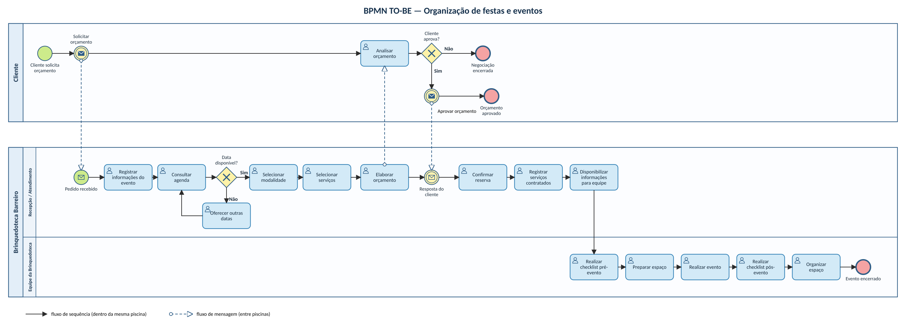
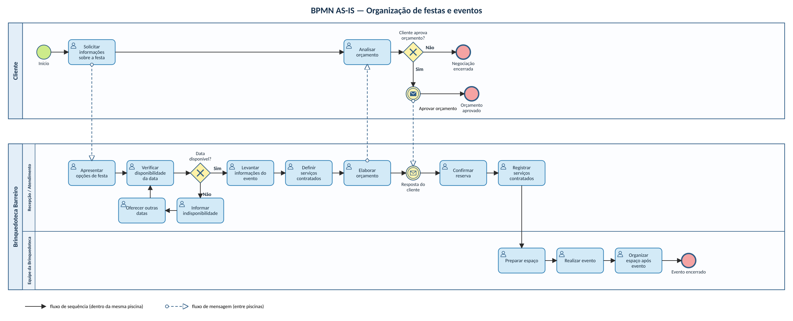

### 3.3.2 Processo 2 – Solicitação, contratação e realização de festas e eventos

O processo acontece na **Brinquedoteca Barreiro** e começa fora dela, quando o cliente pede informações ou faz a solicitação pelo portal do sistema **Virando a Folha**. A parte comercial (orçamento e reserva) é feita pela recepção ou pelo próprio cliente na área do responsável, e a parte operacional (preparar, realizar e organizar a festa) é feita pela equipe da brinquedoteca no salão, com apoio dos checklists do sistema.

**Quem participa**

| Raia (BPMN) | Quem é | Perfil no sistema |
| --- | --- | --- |
| Cliente | Responsável que quer fazer a festa | `RESPONSAVEL` (cria a conta, solicita o evento e acompanha o pedido) |
| Recepção / Atendimento | Recepcionista ou coordenação que consulta a agenda, monta o orçamento, confirma a reserva e escala a equipe | `FUNCIONARIO` (recepção) ou `ADMIN` (coordenação) |
| Equipe da Brinquedoteca | Monitores, recreadores e apoio que preparam e realizam a festa | `FUNCIONARIO` (monitoria), com a tela "Minha escala" |

**Início:** o cliente solicita um orçamento de festa.

**Fim:** há dois finais possíveis. "Negociação encerrada", quando o cliente não aprova o orçamento, e "Evento encerrado", quando a festa foi realizada e o espaço organizado.

**Tarefas (modelo TO-BE):**

1. A recepção registra as informações do evento (data, horário, convidados, endereço e tema) e consulta a agenda.
2. Se a data estiver ocupada, a recepção oferece outras datas e volta à consulta. Se estiver livre, seleciona a modalidade e os serviços e elabora o orçamento.
3. O cliente analisa o orçamento e decide se aprova.
4. Se aprovar, a recepção confirma a reserva, registra os serviços contratados e disponibiliza as informações para a equipe (briefing e escala).
5. A equipe faz o checklist pré-evento, prepara o espaço e realiza o evento.
6. A equipe faz o checklist pós-evento e organiza o espaço.

**Produtos do processo:** o evento (com situação Orçamento, Confirmado ou Cancelado), a ficha de briefing, os serviços contratados com o total do orçamento, a equipe escalada com função e horário de chegada, e os checklists de antes e depois da festa.

**Situações do evento.** Todo evento nasce como `ORCAMENTO` (o cliente vê como "Em análise"). Ao ser confirmado pela coordenação ou recepção, passa a `CONFIRMADO` e o sistema gera os checklists padrão. Pode ir para `CANCELADO` e, depois disso, não pode ser editado nem reaberto.

**Gargalo do AS-IS:** o orçamento não era padronizado e, depois de fechado, a equipe recebia o evento sem repasse formal do que foi contratado e sem checklist do espaço. No TO-BE entram o formulário de cadastro do evento, a ficha de briefing repassada à equipe e os checklists de antes e depois da festa.

##### 3.3.2.1 Modelagem BPMN

**Modelo TO-BE (proposto e implementado no sistema)**

**Modelo AS-IS (situação observada na visita de 25/09/2026), para comparação**

##### 3.3.2.2 Detalhamento das atividades do usuário (user tasks)

#### Detalhamento das atividades

As tabelas abaixo descrevem as telas do sistema que apoiam cada atividade do modelo TO-BE. Os campos, restrições e valores padrão foram conferidos no código do sistema (`public/*.html`, `routes/eventos.js`, `routes/servicos.js` e `database/schema.sql`). As atividades que acontecem só no salão ou por conversa ficam na tabela do final desta seção. A tela de login é a mesma do Processo 1 (CPF e senha).

**Pré-requisito – Criar conta** *(Cliente; tela `criar-conta.html`)*

O responsável não precisa de cadastro prévio: ele cria a própria conta e já entra no sistema.

| **Campo** | **Tipo** | **Restrições** | **Valor default** |
| --- | --- | --- | --- |
| CPF | Caixa de texto | obrigatório; 11 dígitos; não pode ser de funcionário nem de pessoa já cadastrada ("Este CPF já pertence a um responsável.") | |
| Primeiro nome | Caixa de texto | obrigatório; até 50 caracteres | |
| Sobrenome | Caixa de texto | obrigatório; até 100 caracteres | |
| Sexo | Seleção única | obrigatório; Feminino (F), Masculino (M) ou Outro (O) | "Escolha" (vazio) |
| Data de nascimento | Data | obrigatório; não pode ser no futuro | |
| Telefones | Caixa de texto | opcional; separados por vírgula; só dígitos, até 15 por número | |
| Rua | Caixa de texto | obrigatório; até 100 caracteres | |
| Número | Caixa de texto | obrigatório; até 10 caracteres | |
| Bairro | Caixa de texto | obrigatório; até 60 caracteres | |
| Cidade | Caixa de texto | obrigatório; até 60 caracteres | Belo Horizonte |
| Senha | Caixa de texto | obrigatório; mínimo de 6 caracteres | |
| Repita a senha | Caixa de texto | obrigatório; precisa ser igual à senha (senão o cadastro não avança) | |

| **Comandos** | **Destino** | **Tipo** |
| --- | --- | --- |
| Criar conta | Início do responsável (já logado) | default |
| Entrar (link "Já tem conta?") | Tela de login | |

**Registrar informações do evento (solicitar orçamento)** *(Cliente e Recepção; tela `evento.html`, passos 1 e 2)*

O cliente usa a mesma tela pelo menu **Solicitar evento**. Para ele, o campo Responsável fica oculto (é sempre ele mesmo), o passo 4 (equipe) não aparece e o botão final é **Enviar solicitação**.

*Passo 1 – Dados da festa*

| **Campo** | **Tipo** | **Restrições** | **Valor default** |
| --- | --- | --- | --- |
| Responsável | Seleção única | obrigatório (recepção); para o cliente é sempre o próprio responsável | "Escolha o responsável" |
| Data | Data | obrigatória; não pode ser no passado | |
| Horário | Hora | obrigatório | |
| Convidados | Número | obrigatório; inteiro maior que 0 | |
| Rua | Caixa de texto | obrigatória; até 100 caracteres | |
| Número | Caixa de texto | obrigatório; até 10 caracteres | |
| Bairro | Caixa de texto | obrigatório; até 60 caracteres | |
| Cidade | Caixa de texto | obrigatória; até 60 caracteres | Belo Horizonte |

*Passo 2 – Ficha de briefing*

| **Campo** | **Tipo** | **Restrições** | **Valor default** |
| --- | --- | --- | --- |
| Tema | Caixa de texto | obrigatório; até 100 caracteres (ex.: "Fundo do Mar") | |
| Observações | Área de texto | opcional; até 255 caracteres (alergias, faixa etária, surpresas, cores preferidas) | |

| **Comandos** | **Destino** | **Tipo** |
| --- | --- | --- |
| Usar o endereço do responsável | Preenche rua, número, bairro e cidade com o cadastro do responsável | |
| Próximo | Passo seguinte (briefing, depois serviços) | default |
| Voltar | Passo anterior | cancel |
| Voltar para eventos (ou "Voltar para meus eventos") | Lista de eventos, sem salvar | cancel |

**Consultar agenda** *(Recepção e Cliente; aviso automático no passo 1)*

Ao escolher a **Data**, o sistema consulta os eventos já marcados naquele dia (que não estejam cancelados) e mostra um aviso, sem bloquear o cadastro. A decisão "Data disponível?" do modelo continua sendo da pessoa que atende.

| **Campo** | **Tipo** | **Restrições** | **Valor default** |
| --- | --- | --- | --- |
| Data (campo do passo 1) | Data | gatilho da consulta; formato aaaa-mm-dd | |
| Aviso de agenda | Caixa de texto | somente leitura; para a recepção mostra horário, tema e responsável de cada festa do dia; para o cliente mostra só os horários ocupados | oculto quando não há evento no dia |

| **Comandos** | **Destino** | **Tipo** |
| --- | --- | --- |
| Alterar a Data | Nova consulta de agenda (equivale a "Oferecer outras datas") | |
| Próximo | Selecionar serviços (data livre ou aceita pela recepção) | default |

**Selecionar modalidade**

Esta atividade do modelo não tem tela própria. No sistema, a modalidade da festa fica definida pelos serviços escolhidos no passo 3 (decoração, recreação, animação, buffet, fotografia) e pelo tema do briefing.

**Selecionar serviços, Elaborar orçamento e Registrar serviços contratados** *(Recepção e Cliente; `evento.html`, passo 3)*

Cada serviço escolhido vira uma linha. Os serviços do catálogo vêm da tela **Serviços**, mantida pela coordenação.

| **Campo** | **Tipo** | **Restrições** | **Valor default** |
| --- | --- | --- | --- |
| Serviço | Seleção única | obrigatório; escolhido do catálogo; o mesmo serviço não pode aparecer duas vezes ("O mesmo serviço foi escolhido duas vezes. Some as quantidades.") | "Escolha o serviço" |
| Qtd. | Número | obrigatório; inteiro maior ou igual a 1 | 1 |
| Valor unit. (R$) | Número | obrigatório; maior ou igual a 0; duas casas decimais; para o cliente é somente leitura (o preço vem sempre do catálogo) | valor do catálogo ao escolher o serviço |
| Total da linha | Número | somente leitura; quantidade × valor unitário | R$ 0,00 |
| Total do orçamento | Número | somente leitura; soma das linhas | R$ 0,00 |

| **Comandos** | **Destino** | **Tipo** |
| --- | --- | --- |
| Adicionar serviço | Nova linha de serviço | |
| Remover serviço (ícone de lixeira) | Tira a linha e recalcula o total | |
| Próximo (recepção) | Passo 4 – Equipe escalada | default |
| Enviar solicitação (cliente; o passo 3 é o último dele) | Evento gravado como Orçamento, que o cliente vê como "Em análise", com briefing e serviços; segue para Analisar orçamento | default |
| Voltar | Passo anterior | cancel |

Para avançar do passo 3 é preciso ter pelo menos uma linha de serviço ("Inclua pelo menos um serviço na solicitação."). Se a data for anterior a hoje, o sistema responde "A data do evento não pode ser no passado." e nada é gravado. Os serviços contratados ficam gravados junto com o evento, com o valor praticado naquele evento, que pode ser ajustado pela recepção e diferir do catálogo.

**Analisar orçamento** *(Cliente; telas "Meus eventos" e "Minha solicitação")*

| **Campo** | **Tipo** | **Restrições** | **Valor default** |
| --- | --- | --- | --- |
| Filtro de situação | Seleção única | Todos, Em análise, Confirmados ou Cancelados | Todos |
| Lista de eventos | Tabela | somente leitura; colunas Data e horário, Tema, Responsável, Convidados, Valor e Situação; o cliente vê só os eventos dele | |
| Situação | Texto | somente leitura; Em análise (Orçamento), Confirmado ou Cancelado | |

| **Comandos** | **Destino** | **Tipo** |
| --- | --- | --- |
| Abrir | Tela do evento (editável pelo cliente só enquanto estiver Em análise) | default |
| Solicitar evento | Registrar informações do evento | |
| Cancelar evento (cliente não aprova) | Fim "Negociação encerrada"; evento passa a Cancelado | cancel |
| Excluir | Remove o evento enquanto estiver Em análise | |

A aprovação do cliente (gateway "Cliente aprova?") é combinada com a brinquedoteca e registrada pela recepção no passo seguinte. Depois que o evento é confirmado, só a brinquedoteca altera os dados, e o cliente não vê mais o botão de cancelar.

**Confirmar reserva** *(Recepção e Coordenação; `evento.html`, janela de confirmação)*

| **Campo** | **Tipo** | **Restrições** | **Valor default** |
| --- | --- | --- | --- |
| Situação do evento | Seleção única (selo na tela) | Orçamento, Confirmado ou Cancelado; só orçamento pode ser confirmado | Orçamento |
| Janela "Confirmar este evento?" | Texto | somente leitura; avisa que o orçamento foi aprovado pela família e que os checklists serão gerados | |

| **Comandos** | **Destino** | **Tipo** |
| --- | --- | --- |
| Confirmar evento | Evento Confirmado; o sistema gera os checklists de antes e depois; segue para Disponibilizar informações para equipe | default |
| Cancelar evento | Evento Cancelado (não pode ser editado nem reaberto) | |
| Excluir | Remove um evento em orçamento ou cancelado (confirmado precisa ser cancelado antes); a recepção e a coordenação podem excluir os dois casos | |
| Cancelar (na janela de confirmação) | Fecha a janela, sem alterar o evento | cancel |

Para confirmar, o evento precisa ter pelo menos um serviço ("Inclua pelo menos um serviço antes de confirmar o evento."). Os checklists são gerados só na primeira confirmação, com 4 itens antes e 4 depois da festa.

**Disponibilizar informações para equipe** *(Recepção e Coordenação; `evento.html`, passo 4; consulta em "Minha escala")*

*Passo 4 – Equipe escalada (uma linha por pessoa)*

| **Campo** | **Tipo** | **Restrições** | **Valor default** |
| --- | --- | --- | --- |
| Pessoa | Seleção única | obrigatório; lista os funcionários com a função de cada um; a mesma pessoa não pode ser escalada duas vezes | "Escolha" |
| Função na festa | Caixa de texto | obrigatório; até 50 caracteres; sugestões: Coordenação, Recreação, Decoração, Animação e Apoio | |
| Chega às | Hora | obrigatório | |

*Consulta da equipe e do cliente (somente leitura)*

| **Campo** | **Tipo** | **Restrições** | **Valor default** |
| --- | --- | --- | --- |
| Minha escala (Início do funcionário) | Tabela | somente leitura; eventos futuros em que a pessoa está escalada, com tema, função, horário de chegada e itens pendentes do checklist | |
| Equipe da festa (tela do evento, para o cliente) | Tabela | somente leitura; nome, função e horário de chegada de cada pessoa | |

| **Comandos** | **Destino** | **Tipo** |
| --- | --- | --- |
| Adicionar pessoa | Nova linha de equipe | |
| Remover pessoa (ícone de lixeira) | Tira a linha | |
| Salvar orçamento (ao criar) ou Salvar (ao editar um evento existente) | Grava o evento como Orçamento, com briefing, serviços e equipe ("Orçamento criado!" ou "Evento atualizado!"); segue para Analisar orçamento | default |
| Voltar | Passo anterior | cancel |

Cada pessoa escalada precisa ter função e horário ("Cada pessoa da equipe precisa de função e horário."). A escala pode ficar para depois: a tela avisa "Ninguém escalado ainda. Dá para fazer isso depois." e permite editar o evento mais tarde.

**Realizar checklist pré-evento e Realizar checklist pós-evento** *(Equipe e Recepção; `evento.html`, seção "Checklists do evento", só em evento Confirmado e só para a equipe)*

| **Campo** | **Tipo** | **Restrições** | **Valor default** |
| --- | --- | --- | --- |
| Item concluído (um por item) | Seleção múltipla (caixa de marcar) | marcar ou desmarcar a qualquer momento | desmarcado |
| Novo item | Caixa de texto | obrigatório para adicionar; até 150 caracteres; é preciso escolher a lista (Antes da festa ou Depois da festa) | |

Itens padrão gerados na confirmação:

| Antes da festa (PRE) | Depois da festa (POS) |
| --- | --- |
| Confirmar data, horário e endereço com o responsável | Recolher decoração e materiais |
| Conferir a lista de convidados | Conferir pendências e danos |
| Separar decoração, brinquedos e materiais | Registrar o pagamento final |
| Avisar a equipe escalada | Agradecer ao responsável |

| **Comandos** | **Destino** | **Tipo** |
| --- | --- | --- |
| Adicionar (em cada lista) | Inclui o item na lista de antes ou de depois | default |
| Marcar item | Atualiza o item e o contador de pendências em "Minha escala" | |
| Remover item | Apaga o item da lista | |

**Atividades do modelo que não passam por uma tela do sistema**

| Atividade | Raia | O que acontece |
| --- | --- | --- |
| Data disponível? (gateway) | Recepção / Atendimento | A pessoa que atende decide a partir do aviso de agenda. |
| Oferecer outras datas | Recepção / Atendimento | Combinada por conversa com o cliente; o resultado é uma nova data digitada no passo 1. |
| Analisar orçamento / Cliente aprova? | Cliente | O cliente avalia o total do orçamento e responde à brinquedoteca. |
| Preparar espaço | Equipe da Brinquedoteca | Feita no salão, seguindo os itens do checklist pré-evento. |
| Realizar evento | Equipe da Brinquedoteca | A festa acontece com a equipe escalada, conforme o briefing. |
| Organizar espaço | Equipe da Brinquedoteca | Feita no salão, seguindo os itens do checklist pós-evento. |

##### 3.3.2.3 Wireframes (user tasks)

As telas abaixo são capturas reais do sistema, feitas na Atividade 4 (citadas pelo número da figura do documento de evidências).

**Criar conta** *(Figura 2)*

- Dados pessoais, endereço, telefones, senha e confirmação da senha.
- Botão **Criar conta** e link **Entrar**.

**Registrar informações do evento – cliente** *(Figuras 12, 13 e 14)*

.")

.")

.")

- Indicador de etapas no alto, campos do passo e botões **Voltar** e **Próximo**.
- Aviso de agenda aparece abaixo da data quando já existe festa no dia.

**Acompanhar a solicitação – cliente** *(Figura 15)*

**Registrar informações do evento e Consultar agenda – recepção** *(Figuras 33 e 34)*

.")

.")

**Selecionar serviços e Elaborar orçamento** *(Figura 35)*

.")

- Linhas de serviço com quantidade, valor unitário e total da linha, e o **Total do orçamento** no rodapé.
- Botão **Adicionar serviço**.

**Disponibilizar informações para equipe** *(Figuras 36 e 37)*

.")

**Analisar orçamento e acompanhar eventos** *(Figura 30)*

- Abas **Todos**, **Orçamentos**, **Confirmados** e **Cancelados**, e tabela com data, tema, responsável, convidados, valor e situação.

**Confirmar reserva** *(Figura 38)*

**Realizar checklist pré-evento e pós-evento** *(Figura 39)*

- Duas colunas, **Antes da festa** e **Depois da festa**, com caixas de marcar.
- Campo **Novo item** com botão **Adicionar** em cada coluna.